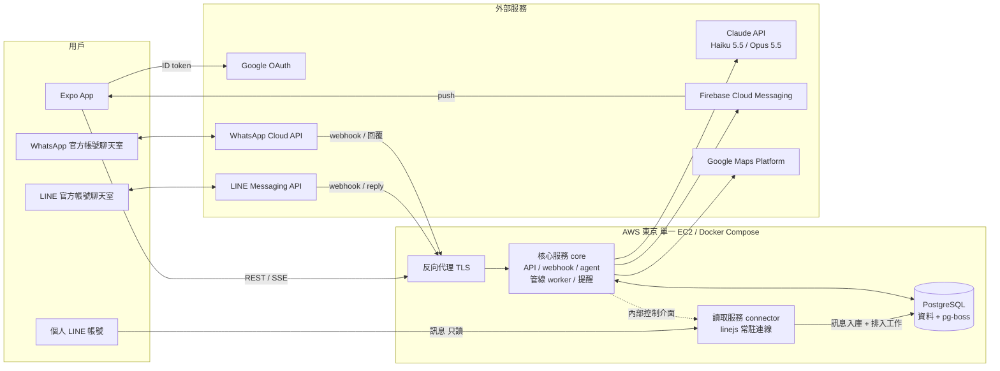
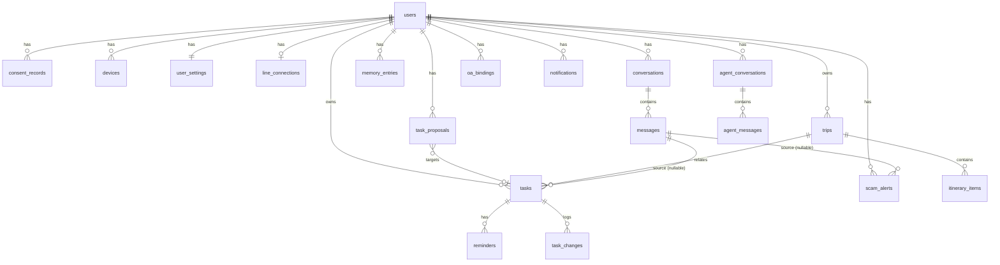
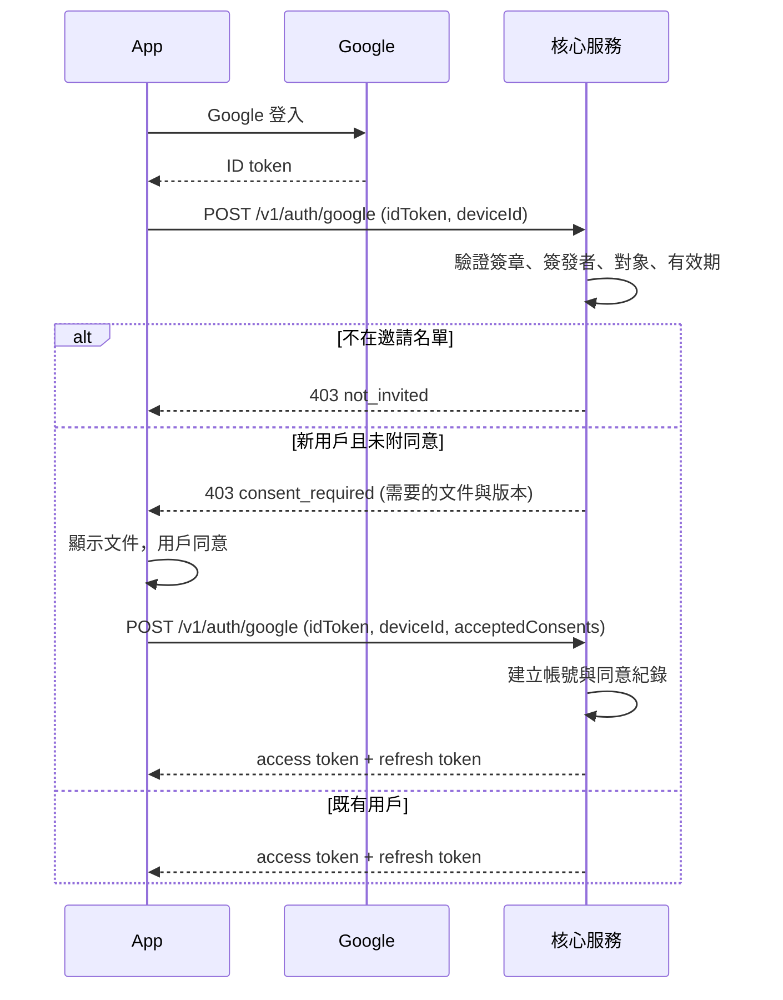
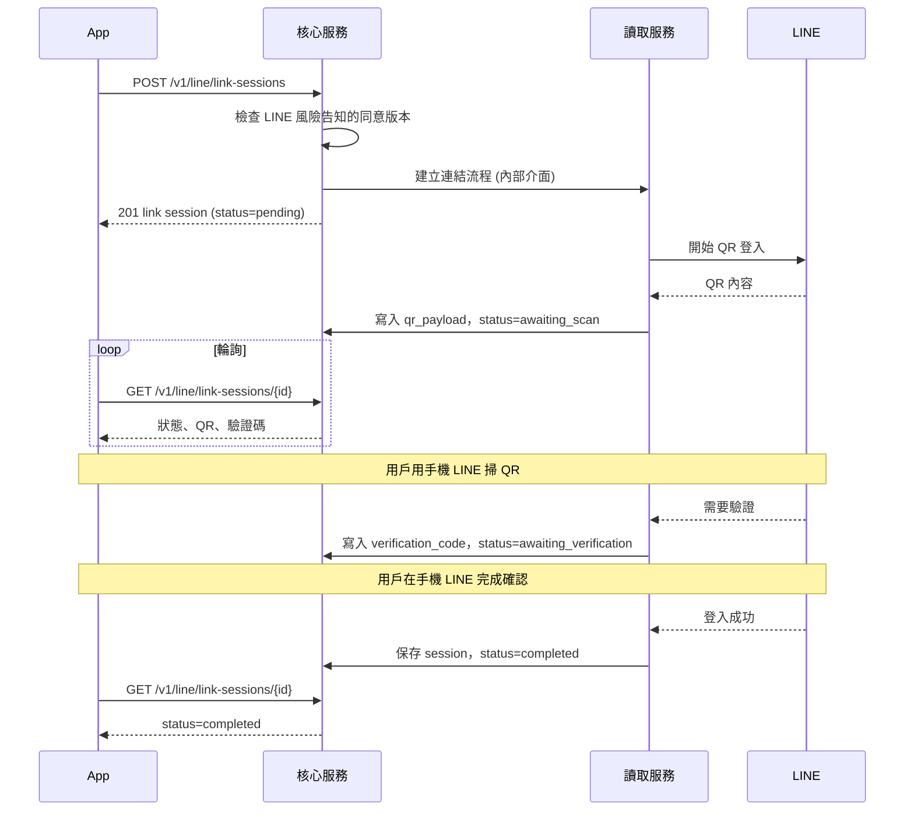
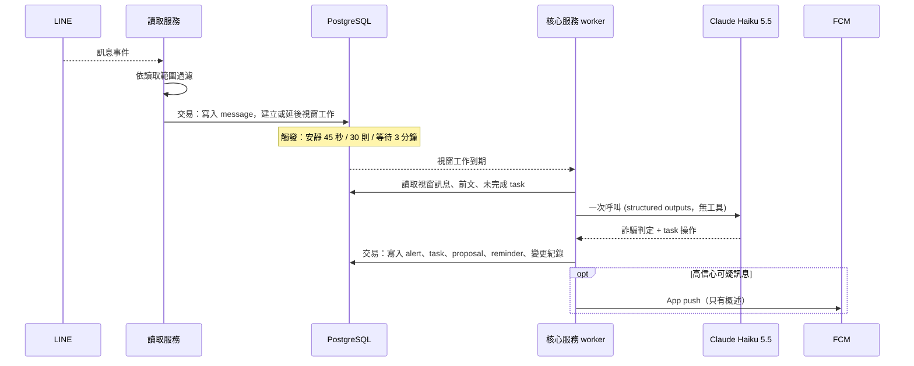
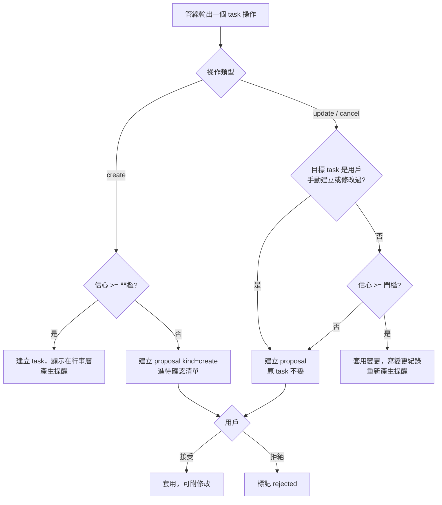
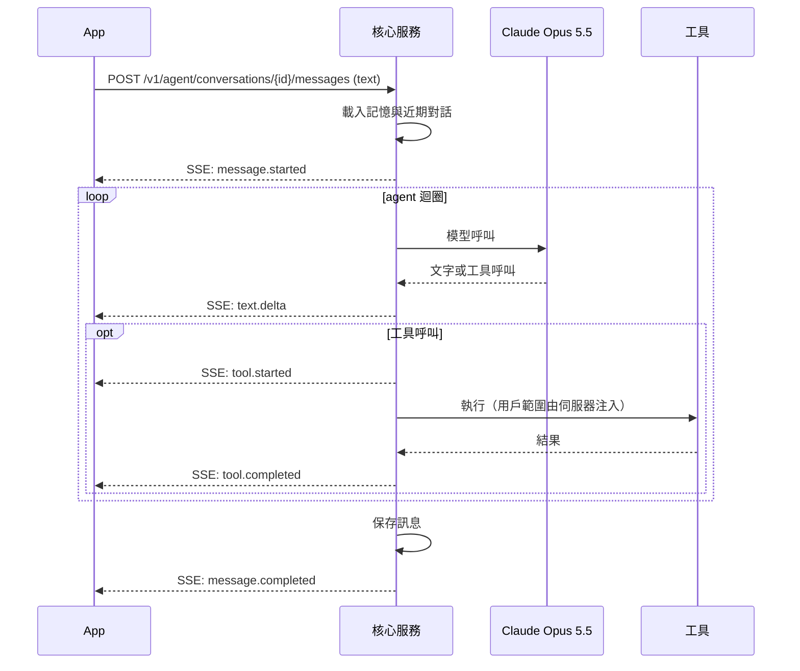
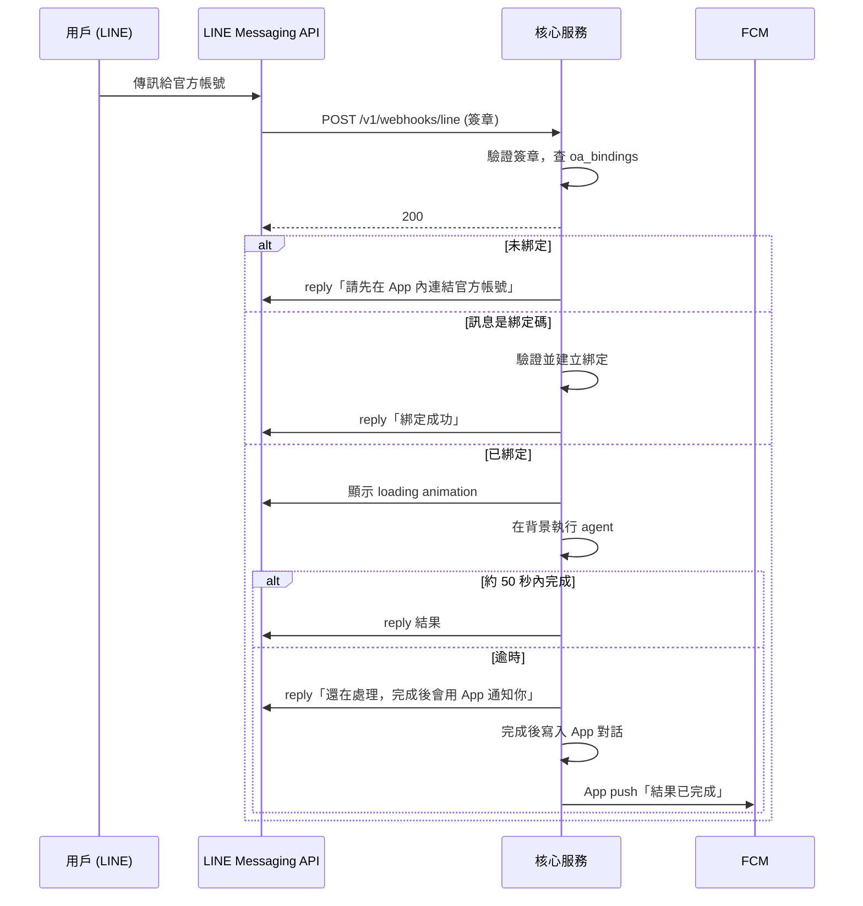
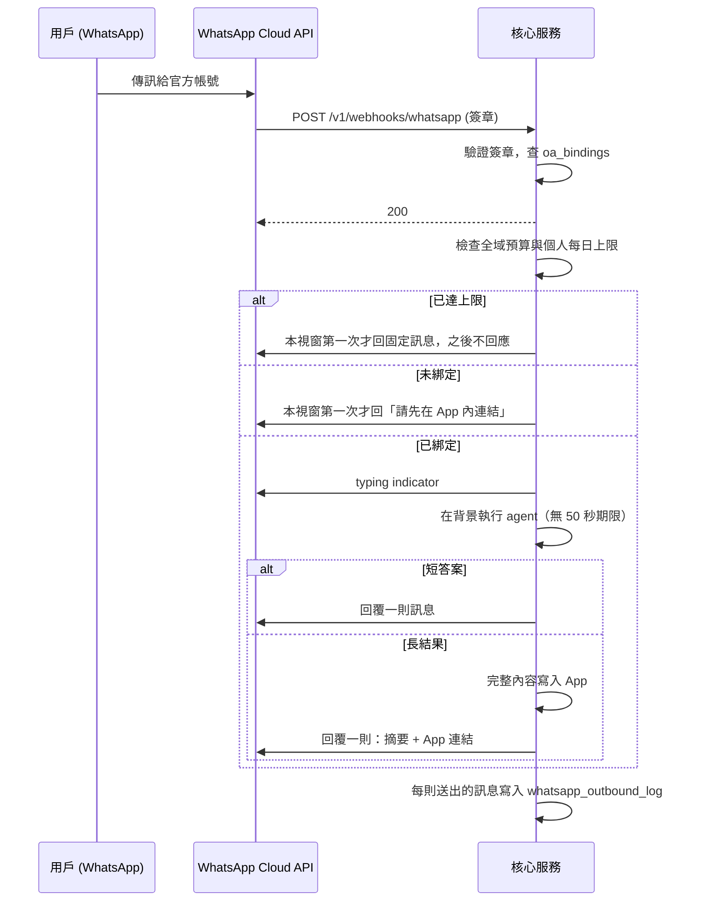
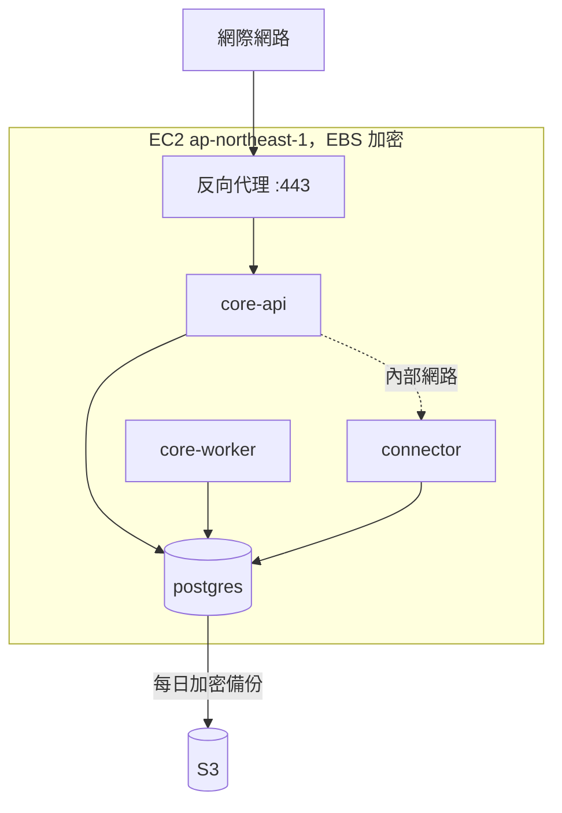

# 系統設計文件

- 狀態：草稿，供實作前審閱
- 日期：2026-11-13
- 更新：2026-11-14，官方帳號通道列為最低優先，內測分兩階段上線
- 範圍：MVP（100 人以下內測）
- 相關文件：[ADR 索引](../adr/README.md)、[OpenAPI spec](../api/openapi.yaml)

本文件把 25 份 ADR 的決定整理成一份可以照著實作的系統設計。決定的理由與被排除的選項都在各 ADR，這裡只寫「系統長什麼樣子、怎麼運作」，並以 ADR 編號標示出處。

ADR 沒有涵蓋、由本文件新訂的預設設計集中列在[第 13 節](#13-adr-未涵蓋本文件新訂的預設)，審閱時請優先看那一節。

## 目錄

1. [目標與非目標](#1-目標與非目標)
2. [系統概觀](#2-系統概觀)
3. [元件設計](#3-元件設計)
4. [資料模型](#4-資料模型)
5. [主要流程](#5-主要流程)
6. [API 設計](#6-api-設計)
7. [安全設計](#7-安全設計)
8. [隱私與法遵](#8-隱私與法遵)
9. [部署與維運](#9-部署與維運)
10. [可觀測性與 eval](#10-可觀測性與-eval)
11. [測試策略](#11-測試策略)
12. [主要風險](#12-主要風險)
13. [ADR 未涵蓋、本文件新訂的預設](#13-adr-未涵蓋本文件新訂的預設)
14. [未決事項與開工前驗證](#14-未決事項與開工前驗證)

## 1. 目標與非目標

### 產品目標

一個 travel planner App，替台灣用戶做四件事：

1. 讀取用戶的個人 LINE 對話，找出要做的事，排進 App 內的行事曆。
2. 在 task 到期前提醒，提前量由 AI 依任務性質決定。
3. 讀到可疑訊息時發出警告。
4. 提供個人 AI agent：規劃逐日逐時的旅遊行程、查詢與更新 task 與行程、記得用戶說過的事。用戶可以在 App、LINE 官方帳號、WhatsApp 官方帳號跟它對話。

**App 是主要的互動介面。** 所有功能都在 App 內可用，不依賴官方帳號通道。兩個官方帳號通道是 agent 的額外入口，在 MVP 內優先順序最低：內測先以 App 上線，官方帳號通道之後再開放。

### MVP 範圍

| 項目 | MVP | 出處 |
|---|---|---|
| 讀取個人 LINE 對話（文字訊息） | 有 | ADR-0001 |
| 讀取個人 WhatsApp 對話 | 延後 | ADR-0001 |
| LINE 官方帳號 agent 通道 | 有，最低優先，內測上線後開放 | ADR-0011 |
| WhatsApp 官方帳號 agent 通道 | 有，最低優先，內測上線後開放 | ADR-0024 |
| App 內行事曆（日、週、月） | 有 | ADR-0008 |
| 與外部行事曆同步 | 不做 | ADR-0008 |
| 資料匯出功能 | 延到正式上線前，內測以人工處理 | ADR-0022 |

### 非目標

- 系統不以用戶的個人帳號發出任何訊息（ADR-0001）。
- 官方帳號不主動發訊，只回覆用戶的提問（ADR-0011、ADR-0024）。
- 不分析圖片、語音、檔案的內容（ADR-0001）。
- 不回補連結 LINE 之前的歷史訊息（ADR-0001）。
- 內測階段不追求高可用，單點故障是已接受的（ADR-0021）。

## 2. 系統概觀



### 元件一覽

| 元件 | 技術 | 職責 | 出處 |
|---|---|---|---|
| App | Expo（React Native、TypeScript） | 行事曆、待確認清單、警告、行程、agent 對話、設定 | ADR-0018 |
| 讀取服務 connector | Node.js 24、linejs | 維持 LINE 連線、收訊、依範圍過濾、入庫並排入工作 | ADR-0001、ADR-0019 |
| 核心服務 core | Node.js 24 | App API、官方帳號 webhook、agent、訊息管線、提醒、推播、背景清除 | ADR-0019 |
| PostgreSQL | PostgreSQL、pg-boss | 唯一的有狀態元件：資料與 job queue | ADR-0020 |
| LLM | Claude API | 管線用 Haiku 5.5，agent 用 Opus 5.5 | ADR-0006 |
| agent 框架 | OpenAI Agents SDK (JS) + AI SDK adapter | agent 迴圈與工具 | ADR-0013 |

### 設計原則

- **單向資料面**：讀取服務只往資料庫寫，核心服務從資料庫讀。兩個服務不直接交換訊息內容。
- **訊息內容一律視為不可信輸入**：管線的 LLM 沒有工具；agent 的工具結果當資料處理（ADR-0007、ADR-0013）。
- **用戶範圍由伺服器決定**：API、agent 工具、資料查詢都從已驗證的身分取得用戶，不接受呼叫端傳入的用戶識別碼（ADR-0013、ADR-0020）。
- **衍生資料不帶原文**：task、警告、記憶只存 AI 整理過的欄位（ADR-0004）。
- **所有門檻與時間常數都是設定**，不寫死在程式裡。

## 3. 元件設計

### 3.1 App

- 畫面：登入與同意、行事曆（日、週、月）、待確認清單、可疑訊息警告、Trip 與行程、agent 對話、記憶管理、對話讀取範圍、LINE 連結、官方帳號綁定、通知中心、設定。
- 透過 [OpenAPI spec](../api/openapi.yaml) 定義的 API 與核心服務溝通；agent 對話用 SSE 串流。
- 登入憑證存在裝置的安全儲存區（ADR-0023）。
- 推播：取得 FCM registration token 後回報後端（ADR-0018）。推播只帶概述，點開後由 App 向後端載入細節。
- 推播權限被關閉時，App 內的通知中心是備援，並提示用戶開啟權限。

### 3.2 讀取服務 connector

職責只有四項（ADR-0019）：

1. 處理連結與中斷連結。
2. 接收訊息事件。
3. 依讀取範圍過濾（ADR-0003）。
4. 把訊息寫入資料庫，並在同一個交易內排入管線工作（ADR-0007、ADR-0020）。

它**不呼叫 LLM、不發推播、不對外提供 API**。

#### Connector 介面

平台無關的介面，LINE 是第一個實作（ADR-0001）：

| 方法或事件 | 說明 |
|---|---|
| `startLink(userId)` | 開始連結流程，回報 QR 與驗證步驟 |
| `cancelLink(sessionId)` | 取消連結流程 |
| `disconnect(userId)` | 停止連線、登出連結裝置、刪除憑證 |
| `onMessage(event)` | 收到訊息 |
| `onConnectionState(event)` | 連線狀態變更 |

介面**沒有任何發訊、已讀、加好友、改設定的方法**。這是「只讀不發」在程式結構上的保證，審查時只要看這個介面。

#### 訊息處理

收到訊息時：

1. 找到或建立對應的對話資料列（名稱、類型）。
2. 判斷是否在讀取範圍內：
   - 一般帳號的一對一與群組：預設讀取，除非用戶排除。
   - 其他官方帳號：預設不讀，除非用戶 opt-in。
   - 本產品自己的官方帳號：一律略過。
3. 範圍外的訊息直接丟棄，只更新對話的最近活動時間。
4. 範圍內的訊息：非文字訊息只記錄類型，不下載內容；寫入 `messages`，並為該對話排入或延後管線視窗工作。

對話的資料列對所有對話都會建立（包含未 opt-in 的官方帳號），因為用戶需要在 App 看到清單才能設定讀取範圍。這些資料列只有名稱與類型，沒有訊息內容。

#### 連線生命週期

- 啟動時從資料庫還原所有有效的 session 並重新連線，分批進行並加上隨機延遲。
- 連線狀態寫入 `line_connections.status`：`connected`、`reconnecting`、`expired`。
- session 失效（被 LINE 登出）時標記 `expired`，並排入一個通知工作，由核心服務發 App push 請用戶重新連結。
- linejs 的 session 狀態透過自訂 storage 存進 PostgreSQL（ADR-0001、ADR-0005）。

#### 內部控制介面

核心服務透過只在容器內部網路開放的 HTTP 介面呼叫讀取服務（ADR-0019）。這個介面不對外，也不在 OpenAPI spec 內。

| 操作 | 說明 |
|---|---|
| 建立連結流程 | 核心服務建立 `line_link_sessions` 後通知讀取服務開始 |
| 取消連結流程 | 用戶取消或逾時 |
| 中斷連結 | 用戶中斷連結或刪除帳號 |
| 重新載入讀取範圍 | 用戶變更排除清單或 opt-in 後，讓讀取服務更新快取 |

連結流程的進度（QR 內容、驗證碼、狀態）由讀取服務寫回 `line_link_sessions`，App 透過核心服務的 API 輪詢。

### 3.3 核心服務 core

同一份程式以兩種模式啟動，內測階段可以跑在同一個程序（ADR-0019）。

#### API 模式

- App API（REST 與 SSE），見第 6 節。
- LINE 與 WhatsApp 的 webhook。
- agent 執行。

#### Worker 模式

| 工作 | 觸發 | 說明 | 出處 |
|---|---|---|---|
| 對話視窗處理 | 延遲工作 | 呼叫 Haiku，產生詐騙判定與 task 操作 | ADR-0007 |
| 提醒發送 | 延遲工作或輪詢 | 檢查 task 狀態後發 App push | ADR-0010 |
| 推播發送 | 佇列 | 呼叫 FCM、處理失效 token | ADR-0018 |
| 連線失效通知 | 讀取服務排入 | 發 App push 請用戶重新連結 | ADR-0001 |
| 保存期清除 | 每日 | 硬刪除過期訊息 | ADR-0004 |
| 帳號刪除 | 用戶請求 | 中斷連結並刪除所有資料 | ADR-0022 |
| 綁定碼與連結流程清理 | 定時 | 刪除過期的一次性資料 | ADR-0012 |

#### 訊息管線

一次 LLM 呼叫完成兩件事（ADR-0007）。輸入：

- 視窗內的新訊息；
- 同一對話較早的若干則訊息；
- 該對話既有的未完成 task；
- 中繼資料：對話類型、對方是否為新聯絡人、用戶時區、目前時間。

輸出（structured outputs）：

```
{
  scam: { suspicious, category, confidence, reason },
  taskOperations: [
    { op: "create" | "update" | "cancel",
      taskId?,            // update 與 cancel 指定既有 task
      title?, date?, time?, allDay?, category?,
      confidence,
      reminders?: [ remindAt ] }
  ]
}
```

管線拿到輸出後由程式決定動作：

- 詐騙判定依信心分級建立警告、決定是否推播（ADR-0009）。
- task 操作依信心門檻分流：達標的直接套用並寫變更紀錄，未達標的建立 proposal（ADR-0008）。
- 目標 task 是用戶手動建立或修改過的，一律建立 proposal，不自動套用。
- 提醒時間先過護欄再寫入（ADR-0010）。
- 模型回傳不存在或不屬於該用戶、該對話的 `taskId` 時，丟棄該操作。

處理必須冪等：以視窗的識別碼為鍵，重跑不會產生重複的 task、警告或推播。

#### Agent

- 用 OpenAI Agents SDK 執行，模型為 Claude Opus 5.5（ADR-0013）。
- 三個通道共用同一組工具與同一份長期記憶（ADR-0014、ADR-0024）。
- 每次執行開始時載入用戶的記憶條目與該對話的近期紀錄。

工具清單：

| 工具 | 讀寫 | 說明 |
|---|---|---|
| `list_tasks`、`get_task` | 讀 | 依日期與狀態查詢 |
| `create_task`、`update_task`、`complete_task`、`cancel_task` | 寫 | 視同用戶手動修改，留變更紀錄 |
| `list_trips`、`get_trip` | 讀 | |
| `create_trip`、`update_trip` | 寫 | |
| `add_itinerary_item`、`update_itinerary_item`、`move_itinerary_item`、`remove_itinerary_item`、`reorder_day` | 寫 | 以項目為單位修改 |
| `list_conversations` | 讀 | 對話清單，供檢索前定位 |
| `search_messages` | 讀 | 關鍵字加條件篩選（ADR-0015） |
| `remember`、`update_memory`、`forget` | 寫 | 記憶條目 |
| `search_places`、`get_place_details`、`compute_route` | 讀 | Google Maps Platform（ADR-0017） |

共通規則：

- 工具不接受用戶識別碼，範圍由執行環境注入。
- 所有寫入都留變更紀錄，可還原。
- 破壞性操作（一次取消或刪除多個項目）要求用戶在對話中確認後才執行。
- 工具結果有筆數與長度上限。

App 是主要通道。兩個官方帳號通道在內測上線後才開放，在那之前系統只有 App 一個通道，下面關於官方帳號的內容都還不生效。

三個通道的回覆方式不同：

| 通道 | 回覆方式 | 出處 |
|---|---|---|
| App | SSE 串流 | ADR-0013 |
| LINE 官方帳號 | 約 50 秒內用 reply 回覆；逾時先回「處理中」，結果寫進 App 並發 App push | ADR-0011 |
| WhatsApp 官方帳號 | 短答案直接回；長結果回摘要加 App 連結；受預算上限控管 | ADR-0024 |

官方帳號通道的對話可以在 App 內接續。用戶被導回 App 看長結果時，可以直接在同一個對話追問：

- 從 App 送出的訊息與回覆只在 App 內進行（SSE），不會送到 LINE 或 WhatsApp。這不違反發訊邊界，因為官方帳號仍然只回覆用戶在官方帳號上的提問。
- 這幾輪存在同一個對話裡，訊息的通道記為 `app`。用戶之後回到官方帳號繼續對話時，agent 把它們當成脈絡的一部分。
- 同一個對話同時只能有一個進行中的回覆，不論從哪個通道發起；另一邊在這期間送來的訊息要等前一個回覆結束。

### 3.4 PostgreSQL

- 唯一的有狀態元件（ADR-0020）。
- job queue 用 pg-boss。
- 中文關鍵字檢索用索引擴充套件（ADR-0015）。
- ADR-0005 建議兩個服務用不同的資料庫角色連線，並讓 `line_connections` 的憑證欄位只授權給讀取服務的角色。這是建議的緩解，ADR 沒有決定採用，於實作時決定。

## 4. 資料模型

### 4.1 實體關聯



### 4.2 資料表

所有業務資料表都有 `user_id`，查詢層統一加上用戶範圍條件（ADR-0020）。

#### 身分與同意

| 資料表 | 主要欄位 | 說明 |
|---|---|---|
| `users` | `id`、`google_sub`（唯一）、`email`、`display_name`、`created_at` | 主鍵不是 email（ADR-0023） |
| `invites` | `email`、`created_at` | 內測邀請名單（ADR-0023） |
| `consent_documents` | `type`、`version`、`url`、`published_at` | 類型：服務條款與隱私政策、LINE 風險告知、LLM 處理與跨境傳輸 |
| `consent_records` | `user_id`、`type`、`version`、`accepted_at` | 每次同意一筆（ADR-0002、ADR-0022） |
| `refresh_tokens` | `user_id`、`device_id`、`token_hash`、`family_id`、`expires_at`、`revoked_at` | 只存雜湊，輪替並偵測重用（ADR-0023） |
| `devices` | `user_id`、`device_id`、`platform`、`fcm_token`、`updated_at` | 一個用戶多台裝置（ADR-0018） |
| `user_settings` | `user_id`、`retention_days`、`time_zone`、`quiet_hours_start`、`quiet_hours_end`、各類通知開關 | 保存期 7、30、90（ADR-0004） |

#### LINE 連結與訊息

| 資料表 | 主要欄位 | 說明 |
|---|---|---|
| `line_connections` | `user_id`、`status`、`credentials`、`linked_at`、`last_event_at` | `credentials` 為明文（ADR-0005） |
| `line_link_sessions` | `id`、`user_id`、`status`、`qr_payload`、`verification_code`、`expires_at` | 連結流程的暫存狀態，短效 |
| `conversations` | `id`、`user_id`、`platform`、`external_id`、`type`、`name`、`ingestion_override`、`first_seen_at`、`last_message_at` | `type`：`direct`、`group`、`official_account`；`ingestion_override`：空值、`include`、`exclude` |
| `messages` | `id`、`user_id`、`conversation_id`、`external_id`、`sender_external_id`、`sender_name`、`direction`、`content_type`、`text`、`sent_at`、`received_at` | `text` 為明文並建立二字組索引；非文字訊息 `text` 為空（ADR-0001、ADR-0015） |
| `pipeline_windows` | `id`、`conversation_id`、`status`、`first_message_at`、`last_message_at`、`message_count`、`processed_at` | 每個對話同時只有一個未處理視窗（ADR-0007） |

`messages` 上有 `(conversation_id, external_id)` 的唯一約束，重複收到同一則訊息時不會重複入庫。

#### Task 與提醒

| 資料表 | 主要欄位 | 說明 |
|---|---|---|
| `tasks` | `id`、`user_id`、`title`、`date`、`time`、`all_day`、`category`、`status`、`source`、`confidence`、`user_modified`、`source_conversation_id`、`source_message_id`、`trip_id` | `status`：`active`、`completed`、`cancelled`；`source`：`pipeline`、`user`、`agent`；來源參照可為空（ADR-0004、ADR-0008） |
| `task_proposals` | `id`、`user_id`、`kind`、`task_id`、`proposed`、`confidence`、`status`、`source_conversation_id`、`source_message_id` | `kind`：`create`、`update`、`cancel`；`status`：`pending`、`accepted`、`rejected`、`superseded` |
| `task_changes` | `id`、`task_id`、`actor`、`before`、`after`、`created_at`、`reverted_at` | `actor`：`pipeline`、`agent`、`user`；可還原（ADR-0008） |
| `reminders` | `id`、`task_id`、`remind_at`、`status`、`origin`、`user_modified` | `status`：`scheduled`、`sent`、`cancelled`；`origin`：`ai`、`user`（ADR-0010） |

`source_message_id` 的外鍵設成刪除時置空，原始訊息到期刪除後參照自動變成空值。

#### 可疑訊息

| 資料表 | 主要欄位 | 說明 |
|---|---|---|
| `scam_alerts` | `id`、`user_id`、`conversation_id`、`category`、`confidence`、`level`、`reason`、`status`、`feedback`、`source_message_id`、`created_at` | `level`：`high`、`medium`；`reason` 是 AI 寫的一句說明，不引用原文（ADR-0009） |

#### 旅遊

| 資料表 | 主要欄位 | 說明 |
|---|---|---|
| `trips` | `id`、`user_id`、`name`、`destination`、`start_date`、`end_date`、`time_zone`、`status`、`notes` | ADR-0016 |
| `itinerary_items` | `id`、`trip_id`、`date`、`start_time`、`end_time`、`type`、`title`、`notes`、`place`、`transport`、`position` | `place`：名稱、地址、座標、地點 ID；`transport`：出發地、目的地、方式、預估時間 |
| `trip_changes` | `id`、`trip_id`、`item_id`、`actor`、`before`、`after`、`created_at`、`reverted_at` | agent 的修改可還原 |

#### Agent

| 資料表 | 主要欄位 | 說明 |
|---|---|---|
| `memory_entries` | `id`、`user_id`、`content`、`source_channel`、`created_at`、`updated_at` | 三個通道共用（ADR-0014） |
| `agent_conversations` | `id`、`user_id`、`channel`、`title`、`created_at`、`last_message_at` | `channel`：`app`、`line_oa`、`whatsapp_oa` |
| `agent_messages` | `id`、`conversation_id`、`role`、`channel`、`content`、`status`、`created_at` | `channel` 是這則訊息實際發生的通道；保存期限未定，見第 14 節 |
| `agent_runs` | `id`、`conversation_id`、`status`、`started_at`、`finished_at`、`delivery` | 追蹤長任務與結果的送達方式 |

#### 官方帳號

| 資料表 | 主要欄位 | 說明 |
|---|---|---|
| `oa_bindings` | `user_id`、`platform`、`external_user_id`、`bound_at` | `platform`：`line`、`whatsapp`；每個平台各一筆；WhatsApp 用 business-scoped user ID（ADR-0012、ADR-0024） |
| `oa_binding_codes` | `code_hash`、`user_id`、`platform`、`expires_at`、`used_at` | 只存雜湊、一次性、10 分鐘（ADR-0012） |
| `whatsapp_outbound_log` | `id`、`user_id`、`kind`、`sent_at` | 計數與對帳，供預算控管（ADR-0024） |

#### 通知

| 資料表 | 主要欄位 | 說明 |
|---|---|---|
| `notifications` | `id`、`user_id`、`type`、`title`、`ref_type`、`ref_id`、`read_at`、`created_at` | App 內通知中心；推播的備援（ADR-0018） |

### 4.3 資料分級

| 等級 | 資料 | 保護 |
|---|---|---|
| 最高 | `line_connections.credentials` | 磁碟加密；明文（ADR-0005）；中斷連結立即刪除 |
| 高 | `messages.text`、`agent_messages.content` | 磁碟加密；明文；`messages` 有保存期 |
| 中 | task、行程、記憶、警告 | 磁碟加密；不含原文 |
| 低 | 設定、對話名稱與類型 | 磁碟加密 |

## 5. 主要流程

### 5.1 登入與同意



- 文件改版後，受影響的功能回 `403 consent_required`，App 引導用戶重新同意（ADR-0022）。
- refresh token 每次使用就輪替；偵測到舊 token 被重用時撤銷整串（ADR-0023）。

### 5.2 連結 LINE



linejs 的 QR 與 pincode 的實際順序尚未驗證（ADR-0001）。API 的狀態刻意設計成通用的：`pending`、`awaiting_scan`、`awaiting_verification`、`completed`、`failed`、`expired`、`cancelled`。App 依狀態顯示 QR 或驗證碼，不假設特定順序。

### 5.3 訊息管線



觸發條件的三個數值是初始值（ADR-0007）。

### 5.4 Task 分流與後續變更



- 門檻初始值 0.8（ADR-0008）。「取消」是否用更高的門檻未定。
- 同一個 task 有新的 proposal 時，舊的未處理 proposal 標記為 `superseded`。
- 用戶接受 proposal 視同用戶手動修改。
- proposal 不帶提醒。用戶接受時才以當下的時間產生提醒並套用護欄（ADR-0010），因為接受的時間可能比建議產生時晚很多。

### 5.5 到期提醒

1. 建立或修改 task 時，AI 產生的提醒時間先過護欄（ADR-0010）：
   - 不早於現在、不晚於到期時間；
   - 每個 task 最多 3 個；
   - 勿擾時段內的提醒提前到時段開始之前；提前後已過去的，依 ADR-0010 的規則立即發送或延到時段結束。
2. 每個提醒寫入 `reminders`，並排入對應時間的工作。
3. 到期時 worker 重新讀取 task：已完成或已取消的不發。
4. 透過 FCM 發 App push，並寫入通知中心。
5. task 時間變更時，刪除未發出的舊提醒並重新產生；用戶手動調整過的提醒依相同提前量平移。

### 5.6 可疑訊息警告

| 信心 | 動作 |
|---|---|
| 高 | 建立 `level=high` 的警告，發 App push，寫入通知中心 |
| 中 | 建立 `level=medium` 的警告，只在 App 內標示 |
| 低 | 不建立警告 |

- 同一個對話短時間內只推播一次（ADR-0009）。
- 用戶可以回報「這不是詐騙」，回報寫入 `scam_alerts.feedback`，供擴充 eval 集。
- 推播只說某個對話出現可疑訊息；對話名稱、手法分類、理由在 App 內載入。

### 5.7 App 內的 agent 對話



App 斷線後 agent 繼續執行到結束，結果保存在對話紀錄，App 重新連線後用訊息列表取得。

### 5.8 LINE 官方帳號對話



出處：ADR-0011、ADR-0012。官方帳號永不使用 LINE 的 push message。

### 5.9 WhatsApp 官方帳號對話



出處：ADR-0024。只在 24 小時 customer service window 內發送，不發 template 訊息。預算與上限的數值未定。

### 5.10 官方帳號綁定

1. App 呼叫 `POST /v1/oa-bindings/{platform}/codes`，後端產生綁定碼，只存雜湊，10 分鐘有效。
2. 回應帶有 deep link：LINE 用開啟官方帳號並預填訊息的 URL scheme，WhatsApp 用 `wa.me` 連結。
3. 用戶在聊天室按送出。
4. webhook 收到後驗證雜湊、有效期、未使用，建立 `oa_bindings`，回覆綁定成功，並在 App 通知中心寫入一則綁定通知，讓用戶能發現非本人的綁定。
5. 驗證失敗有次數限流。

### 5.11 保存期清除、中斷連結、刪除帳號

| 事件 | 動作 | 出處 |
|---|---|---|
| 每日清除 | 硬刪除超過用戶保存期的 `messages`；task 與警告的來源參照自動置空 | ADR-0004 |
| 用戶縮短保存期 | 下一次清除就套用 | ADR-0004 |
| 用戶把對話改成不讀取 | 停止讀取，並刪除該對話已保存的訊息；衍生的 task 與警告保留 | ADR-0003、ADR-0015 |
| 中斷 LINE 連結 | 停止連線、登出連結裝置、刪除憑證；預設一併刪除已保存的訊息；task、行程、記憶保留 | ADR-0022 |
| 刪除帳號 | 先做中斷連結，再刪除該用戶所有資料與官方帳號綁定；撤銷所有 token | ADR-0022 |

刪除帳號是非同步工作。API 接受請求後立即撤銷 token，背景工作完成中斷連結與資料刪除。備份中的資料在備份過期後消失。

ADR-0022 要求刪除完成後通知用戶。但刪除會先撤銷 token 與推播 token，完成時已經沒有 App 內的管道可以通知。目前的設計只在請求被接受時由 App 顯示確認畫面；完成通知要用什麼管道（例如寄到 Google 帳號的 email，這會多一個寄信服務）列為未決事項，見第 14 節。

## 6. API 設計

完整定義在 [OpenAPI spec](../api/openapi.yaml)。這裡說明慣例與資源分組。

### 6.1 慣例

- 基底路徑 `/v1`。
- 認證：`Authorization: Bearer <access token>`。webhook 不用 bearer，改用平台的簽章標頭；登入、換發 token、取得同意文件這三個端點不需要認證。
- **路徑與請求內容都沒有用戶識別碼**，用戶一律從 token 取得。
- 錯誤回應用 `application/problem+json`，並帶一個機器可讀的 `code`。
- 列表用游標分頁：`limit`、`cursor`，回應帶 `nextCursor`。
- 時間用 ISO 8601 UTC；日期用 `YYYY-MM-DD`；當地時間用 `HH:mm`，搭配明確的時區欄位。
- 識別碼是 UUID 字串。

### 6.2 資源分組

| 分組 | 路徑 | 對應 ADR |
|---|---|---|
| 認證 | `/auth/*` | ADR-0023 |
| 同意 | `/consent-documents`、`/me/consents` | ADR-0002、ADR-0022 |
| 帳號與設定 | `/me`、`/me/settings`、`/me/deletion` | ADR-0004、ADR-0010、ADR-0022 |
| 裝置與推播 | `/me/devices/{deviceId}/push-token` | ADR-0018 |
| LINE 連結 | `/line/connection`、`/line/link-sessions` | ADR-0001、ADR-0002 |
| 對話讀取範圍 | `/conversations` | ADR-0003 |
| 行事曆 | `/calendar` | ADR-0008、ADR-0016 |
| Task | `/tasks`、`/tasks/{id}/reminders`、`/tasks/{id}/changes`、`/tasks/{id}/source` | ADR-0004、ADR-0008、ADR-0010 |
| 待確認清單 | `/task-proposals` | ADR-0008 |
| 可疑訊息 | `/scam-alerts` | ADR-0009 |
| 旅遊 | `/trips`、`/trips/{id}/items` | ADR-0016 |
| Agent | `/agent/conversations`、`/agent/memories` | ADR-0013、ADR-0014 |
| 官方帳號綁定 | `/oa-bindings` | ADR-0012、ADR-0024 |
| 通知中心 | `/notifications` | ADR-0018 |
| Webhook | `/webhooks/line`、`/webhooks/whatsapp` | ADR-0011、ADR-0024 |

### 6.3 幾個刻意的設計

- **待確認清單是獨立資源**。`task_proposals` 同時表達「低信心的新 task」與「對既有 task 的修改或取消建議」，後者無法用 task 的狀態表達。
- **來源訊息是唯一會回傳原文的端點**。`GET /tasks/{id}/source` 與 `GET /scam-alerts/{id}/source` 在保存期內回傳來源訊息與前後文；訊息過期後回 `410 source_expired`。task、警告、記憶的資料結構本身都不含原文（ADR-0004）。
- **沒有瀏覽全部訊息的端點**。App 不是聊天紀錄檢視器；原文只透過來源端點與 agent 的檢索取得。
- **沒有資料匯出端點**。內測由人工處理（ADR-0022）。
- **LINE 連結是非同步資源**。`link-sessions` 有狀態，App 輪詢。
- **agent 訊息帶通道欄位**。官方帳號通道的問答會出現在 App 的對話列表中（ADR-0011、ADR-0024），用戶可以在 App 內接著問下去。對話的 `channel` 表示它在哪裡開始，訊息的 `channel` 表示那一則實際發生在哪裡。
- **兩個閘門錯誤碼**：`not_invited` 與 `consent_required`，讓 App 能分別引導。

## 7. 安全設計

### 7.1 信任邊界

| 邊界 | 控制 |
|---|---|
| 網際網路到核心服務 | TLS；bearer token；webhook 驗證簽章；限流 |
| 核心服務到讀取服務 | 只在容器內部網路；讀取服務不對外開放任何埠 |
| 服務到資料庫 | 只在容器內部網路；兩個服務是否使用不同角色於實作時決定（ADR-0005） |
| 訊息內容到 LLM | 視為不可信輸入；管線無工具；輸出受 schema 約束 |
| agent 工具結果 | 視為資料；寫入留紀錄；破壞性操作需確認 |

### 7.2 認證與授權

- Google ID token 驗證後簽發自己的 access token 與 refresh token（ADR-0023）。
- 授權模型只有一條：用戶只能存取自己的資料。沒有管理者 API。
- 存取他人資源一律回 `404`，不回 `403`，避免洩漏資源是否存在。

### 7.3 Webhook

- LINE：驗證 `X-Line-Signature`（ADR-0012）。
- WhatsApp：驗證 `X-Hub-Signature-256`；另有 Meta 的 GET 驗證握手（ADR-0024）。
- 簽章驗證失敗回 `401`，不處理內容。
- 驗證通過後立即回 `200`，實際處理在背景進行；以平台的事件識別碼去重。

### 7.4 Prompt injection

訊息內容與外部資料可能夾帶針對模型的指令。

- **管線**：模型沒有工具，只能輸出固定 schema。最壞情況是該視窗的判定被影響：漏報詐騙，或產生假的 task。高信心才自動進行事曆限制了後者（ADR-0007、ADR-0008）。
- **agent**：會讀到歷史訊息與地點資料，而且有寫入工具。緩解：工具結果標示為資料、破壞性操作需確認、所有寫入可還原、工具無法跨用戶（ADR-0013）。
- agent 沒有任何能對外發送資料的工具（沒有發訊、沒有任意 HTTP 請求），地圖工具的查詢字串是唯一的對外通道，system prompt 指示不放個人資訊（ADR-0017）。

### 7.5 已接受的風險

ADR-0005 決定訊息內文與 LINE 憑證都只靠磁碟加密。**資料庫的讀取權限等同於所有用戶的對話明文與 LINE 帳號控制權**。因此：

- 資料庫不對外開放；
- 備份加密並限制存取；
- 應用程式的任何 SQL injection 或遠端執行漏洞都是最高嚴重度；
- 正式上線前必須重新檢視這個決定。

### 7.6 Secrets

Anthropic API key、Google 與 Firebase 的金鑰、LINE channel secret、WhatsApp 的 token 與 app secret、token 簽章金鑰都不進 repository（ADR-0021）。Google Maps 的金鑰只存在後端（ADR-0017）。

## 8. 隱私與法遵

細節見 ADR-0022。本節是工程上要落實的清單，不是法律意見。

### 8.1 資料流向

| 資料 | 去向 | 目的 |
|---|---|---|
| 對話內容、task、agent 對話 | Anthropic（美國） | LLM 處理 |
| 全部資料 | AWS（日本） | 儲存與運算 |
| 推播 token 與概述文字 | Google FCM、Apple APNs | 推播 |
| 地點查詢字串與座標 | Google Maps Platform | 行程規劃 |
| 登入身分 | Google OAuth | 登入 |
| 官方帳號上的 agent 對話 | LINE、Meta | 對話通道 |

**不送到 OpenAI**：OpenAI Agents SDK 的 tracing 必須關閉（ADR-0013）。

### 8.2 用戶權利的實作

| 權利 | MVP 的做法 |
|---|---|
| 知情 | 隱私政策、LINE 風險告知、同意紀錄 |
| 限制處理 | 讀取範圍設定、中斷 LINE 連結 |
| 刪除 | 刪除帳號、刪除個別 task、行程、記憶、agent 對話 |
| 查閱 | App 內可見所有衍生資料與記憶；完整匯出由人工處理 |
| 更正 | task、行程、記憶都可編輯 |
| 反對自動化決策 | 待確認清單、變更紀錄與還原、詐騙誤判回報 |

### 8.3 資料最小化的落實點

- 讀取範圍外的訊息在讀取服務就丟棄（ADR-0003）。
- 衍生資料不複製原文（ADR-0004）。
- 推播不帶原文（ADR-0018）。
- 不保存 WhatsApp 電話號碼（ADR-0024）。
- 應用程式日誌不記錄訊息內文、agent 對話內容、LLM 的輸入輸出。
- Google 登入只要求基本資料與 email（ADR-0023）。

## 9. 部署與維運

### 9.1 內測部署

出處：ADR-0021。



- 對外只開放 443，路由到核心服務的 API 與 webhook。
- `core-api` 與 `core-worker` 用同一個映像，不同的啟動模式。
- 兩個服務分開部署：部署核心服務不重啟讀取服務。
- EC2、安全群組、磁碟、S3 用 Terraform 建立。
- 映像由 GitHub Actions 建置。

### 9.2 設定

所有門檻與時間常數集中在設定，初始值如下：

| 設定 | 初始值 | 出處 |
|---|---|---|
| 視窗安靜時間 | 45 秒 | ADR-0007 |
| 視窗訊息上限 | 30 則 | ADR-0007 |
| 視窗最長等待 | 3 分鐘 | ADR-0007 |
| task 信心門檻 | 0.8 | ADR-0008 |
| 每個 task 提醒上限 | 3 個 | ADR-0010 |
| 預設勿擾時段 | 22:00 到 08:00 | ADR-0010 |
| LINE 官方帳號回覆期限 | 50 秒 | ADR-0011 |
| 綁定碼有效期 | 10 分鐘 | ADR-0012 |
| 保存期選項 | 7、30、90 天 | ADR-0004 |
| 詐騙通知的信心分級 | 未定 | ADR-0009 |
| WhatsApp 每月預算、每人每日上限、長結果門檻 | 未定 | ADR-0024 |
| 記憶條目上限 | 未定 | ADR-0014 |

### 9.3 備份與還原

- PostgreSQL 每日備份到同區域的 S3，加密、限制存取、設定保存天數（ADR-0021）。
- 備份保存天數寫進隱私政策。
- 定期演練還原。

### 9.4 故障行為

| 故障 | 影響 | 行為 |
|---|---|---|
| 讀取服務停擺 | 不收新訊息 | App、agent、行事曆照常；恢復後重連。停擺期間的訊息能否補收未驗證 |
| LINE 改版導致 linejs 失效 | 所有用戶的讀取中斷 | 連線標記失效並通知用戶；其餘功能照常 |
| Claude API 不可用 | 管線與 agent 停擺 | 視窗工作重試；agent 回覆錯誤訊息；訊息仍持續入庫 |
| FCM 不可用 | 推播延遲 | 重試；通知中心仍可見 |
| 資料庫或 VM 停擺 | 全部停擺 | 已接受的單點故障 |

### 9.5 轉到正式環境

正式上線前轉到 ECS Fargate 與 RDS，用 Terragrunt 管理多環境（ADR-0021）。應用程式只依賴 PostgreSQL 與容器。

各容器在多副本時怎麼對應到用戶：

| 容器 | 多副本時 | 出處 |
|---|---|---|
| 核心服務 API | 不綁定用戶。請求送到任一容器，用戶由 token 決定 | ADR-0020、ADR-0023 |
| 核心服務 worker | 不綁定用戶。各容器向 job queue 取工作，一個工作只會被一個容器取走 | ADR-0020 |
| 讀取服務 | 每條用戶連線同一時間只由一個容器持有，以資料庫租約分配 | ADR-0019、ADR-0025 |

讀取服務放上 ECS 之前要先實作 ADR-0025 的連線租約，即使一開始只跑一個容器：ECS 的滾動部署預設先啟動新容器再停掉舊容器，沒有租約時兩個容器會同時用同一份憑證登入。這是轉到 ECS 時讀取服務需要改的部分，核心服務也要改成依持有者呼叫讀取服務。租約需要的資料表與欄位屬於正式上線前的工作，不在第 4.2 節的 MVP 資料模型內。內測的 Docker Compose 部署是先停後啟，不受影響。

讀取服務轉到 ECS 時從一個容器開始，連線數接近單一容器的容量上限時再加容器。

## 10. 可觀測性與 eval

### 10.1 日誌與指標

日誌用結構化格式，**不含訊息內文、agent 對話內容、LLM 的輸入輸出**。只記錄識別碼、計數、耗時、狀態。

需要的指標：

| 類別 | 指標 |
|---|---|
| 讀取 | 各狀態的連線數、每分鐘訊息數、異常登出次數、重連次數 |
| 管線 | 視窗延遲（訊息收到至處理完成）、佇列深度、失敗與重試次數、每次呼叫的 token 數 |
| 判定 | 各信心區間的 task 操作數、proposal 接受率與拒絕率、變更還原次數、警告數與誤判回報數 |
| 提醒與推播 | 發送數、失敗數、token 失效數、提醒延遲 |
| agent | 每通道的執行次數、耗時、工具呼叫次數、LINE 逾時比例、WhatsApp 送出則數與預算使用率 |
| 成本 | 每日 LLM 花費、Google Maps 呼叫數 |

告警（最低限度）：異常登出數突增、管線佇列持續堆積、WhatsApp 預算使用率達到門檻、備份失敗。

ADR-0002 沒有採用自動停損，但建議記錄異常登出事件並設簡單告警，上面的「異常登出數突增」就是這一項。

### 10.2 Eval

詐騙判定是純 LLM、模型是 Haiku（ADR-0006、ADR-0009），eval 集是唯一的品質把關。

- **資料**：標註過的對話片段，涵蓋各類詐騙手法、正常對話、含 task 的對話、改期與取消、容易誤判的案例（例如親友真的借錢、真的投資討論）。以合成與去識別化的資料為主，不直接使用內測用戶的原文。
- **衡量**：詐騙判定的精確率與召回率；task 抽取的正確率、重複率、日期時間的正確率；信心分數的校準程度。
- **使用時機**：每次修改管線 prompt、更換模型、調整門檻之前都要跑。
- **回饋**：用戶的誤判回報與 proposal 的拒絕紀錄是擴充 eval 集的線索，但轉成 eval 資料前要去識別化。

## 11. 測試策略

| 層級 | 重點 |
|---|---|
| 單元測試 | 提醒護欄（勿擾時段的邊界）、信心分流、綁定碼驗證、token 輪替與重用偵測、讀取範圍判斷、WhatsApp 預算計數 |
| 整合測試 | 用真實的 PostgreSQL 容器測試：訊息入庫與工作入列的交易性、視窗去重、管線冪等、保存期清除後參照置空、用戶範圍隔離 |
| 契約測試 | API 的請求與回應符合 OpenAPI spec |
| LLM 測試 | 管線用錄製的模型回應測試程式邏輯；品質用 eval 集另外衡量 |
| 端對端測試 | 登入、連結（用假的 connector 實作）、訊息到 task、提醒、agent 對話 |
| 安全測試 | 跨用戶存取一律 404、webhook 簽章驗證、prompt injection 樣本 |

讀取服務的 connector 介面要有一個假的實作，讓其餘部分不需要真的 LINE 帳號就能測試。

## 12. 主要風險

| 風險 | 影響 | 緩解 | 出處 |
|---|---|---|---|
| LINE 封鎖用戶帳號 | 用戶主帳號受損 | 連結前明確告知並留存同意；監控異常登出 | ADR-0002 |
| linejs 隨 LINE 改版失效 | 核心功能中斷 | 讀取服務獨立；其餘功能照常 | ADR-0001 |
| 資料庫被讀取 | 所有對話外洩、LINE 帳號被冒用 | 資料庫不對外；備份加密；上線前重新檢視 | ADR-0005 |
| 詐騙漏報或誤報 | 產品失職或用戶麻木 | eval 集；用戶回報；分級通知 | ADR-0009 |
| agent adapter 不相容 | agent 無法實作 | 開工前驗證；備案是 Anthropic SDK 的 Tool Runner | ADR-0013 |
| 第三方對話的法律依據未確立 | 可能推翻讀取範圍與保存方式 | 內測前完成 DPIA；上線前法律審閱 | ADR-0022 |
| 單點故障 | 停擺期間漏訊息 | 已接受；備份與還原演練 | ADR-0021 |
| WhatsApp 費用失控 | 超出預算 | 全域預算與個人上限；同一視窗只回一次固定訊息 | ADR-0024 |

## 13. ADR 未涵蓋、本文件新訂的預設

下列是撰寫本文件與 OpenAPI spec 時新訂的設計，ADR 沒有決定過。它們都是慣用的做法，可以直接調整，不需要推翻任何 ADR。**審閱時請確認這些是否符合預期。**

### API 慣例

| 項目 | 本文件的預設 |
|---|---|
| 版本 | 路徑前綴 `/v1` |
| 識別碼 | UUID 字串 |
| 分頁 | 游標分頁，`limit` 預設 50、上限 100 |
| 錯誤格式 | `application/problem+json` 加上 `code` 欄位 |
| 存取他人資源 | 回 `404` |
| access token 有效期 | 15 分鐘 |
| refresh token 有效期 | 30 天，每次使用輪替 |
| SSE 事件名稱 | `message.started`、`text.delta`、`tool.started`、`tool.completed`、`message.completed`、`error` |
| task 類型的列舉值 | `payment`、`meeting`、`appointment`、`deadline`、`travel`、`social`、`errand`、`other` |
| 詐騙手法的列舉值 | 依 ADR-0009 列出的手法訂定英文代碼，另加 `other` |
| 行程項目類型與交通方式的列舉值 | 類型依 ADR-0016；交通方式為 `walk`、`transit`、`drive`、`taxi`、`train`、`flight`、`other` |
| 行事曆查詢範圍 | 一次最多 62 天 |
| 伺服器網域 | 尚未決定，spec 內是占位值 |

### 行為

| 項目 | 本文件的預設 |
|---|---|
| 首次登入的同意 | 在 `POST /auth/google` 的請求中一併送出，沒有附就回 `consent_required` |
| 刪除帳號的再次確認 | 要求附上新取得的 Google ID token |
| 刪除帳號 | 非同步；接受請求後立即撤銷 token |
| LINE 連結流程 | App 輪詢 `link-sessions`，不用推送 |
| 對話資料列 | 所有對話都建立資料列（只有名稱與類型），包含未 opt-in 的官方帳號，供用戶設定讀取範圍 |
| 把對話改成不讀取 | 一併刪除該對話已保存的訊息，讓「被排除的對話沒有訊息入庫」（ADR-0015）持續成立 |
| proposal 的提醒 | proposal 不帶提醒，接受時才產生 |
| 內測分兩階段上線（已確認） | 內測先以 App 上線。LINE 與 WhatsApp 官方帳號通道是 MVP 內最低優先的工作，之後通過另一道檢查才開放。App 主線的功能不可以依賴官方帳號通道 |
| 官方帳號通道對內測用戶開放前（未確認） | 發給內測用戶的 App 版本不顯示官方帳號綁定的入口；官方帳號與 webhook 只供內部測試使用 |
| App 內的 agent 對話 | 用戶可以開多個對話；每個官方帳號通道各有一個持續的對話 |
| 在 App 接續官方帳號通道的對話（已確認） | 可以。這一輪問答只在 App 內進行，回覆不送到 LINE 或 WhatsApp；之後回到官方帳號時，agent 看得到 App 內的這幾輪 |
| 記憶條目 | 用戶可以查看、修改、刪除，但不能自己新增；新增只透過 agent |
| proposal 被取代 | 同一個 task 有新的 proposal 時，舊的標記 `superseded` |
| 來源訊息端點 | 回傳來源訊息與前後各數則；過期回 `410` |
| 還原變更 | 只能還原最新一筆尚未還原的變更；還原本身也留紀錄 |
| 用戶手動設定的提醒 | 不受勿擾時段限制，但仍受數量上限與時間範圍限制 |
| 中斷 LINE 連結 | 以參數決定是否一併刪除已保存的訊息，預設刪除 |
| 產生新的綁定碼 | 同一平台先前未使用的綁定碼失效 |
| agent 對話的同時執行 | 同一個對話同時只能有一個進行中的回覆 |
| 通知中心 | 所有推播同時寫入 `notifications` |
| 綁定成功通知 | 寫入通知中心，讓用戶發現異常綁定 |
| 兩個服務的溝通 | 控制面用內部 HTTP，資料面用 PostgreSQL |
| `agent_runs` | 追蹤長任務的執行狀態與送達方式 |

## 14. 未決事項與開工前驗證

完整清單在 [ADR 索引](../adr/README.md)。這裡列出會直接影響本文件與 API 的項目。

### 未決事項

| 項目 | 對設計的影響 | 出處 |
|---|---|---|
| agent 對話紀錄的保存期限 | `agent_messages` 的清除工作；可能含有檢索到的原文 | ADR-0014 |
| 旅遊行程項目的提醒規則 | 暫定只提醒 Trip 的開始；`itinerary_items` 目前沒有提醒 | ADR-0016 |
| 取消 task 是否用更高的信心門檻 | 分流邏輯多一個設定 | ADR-0008 |
| 記憶條目的數量上限 | agent 的整併行為 | ADR-0014 |
| WhatsApp 的預算、每日上限、長結果門檻 | 要先查到台灣區費率 | ADR-0024 |
| 詐騙通知的信心分級數值 | 高、中、低的切點 | ADR-0009 |
| 帳號刪除完成的通知管道 | 刪除後沒有 App 內的管道；用 email 會多一個寄信服務與委外處理者 | ADR-0022 |

### 開工前驗證

| 項目 | 不通過時要改的地方 | 出處 |
|---|---|---|
| OpenAI Agents SDK adapter 搭配 Claude Opus 5.5 | 第 3.3 節的 agent 實作；備案是 Tool Runner | ADR-0013 |
| linejs 的端對端加密支援、裝置類型、連線穩定性 | 整個讀取服務 | ADR-0001 |
| linejs 能否區分一般帳號與官方帳號 | 第 3.2 節的讀取範圍判斷 | ADR-0003 |
| linejs 的 QR 與驗證碼順序 | 第 5.2 節；API 的狀態已設計成通用的 | ADR-0001 |
| 停擺後能否補收訊息 | 第 9.4 節的故障行為 | ADR-0021 |
| Expo 取得 iOS 的 FCM token | App 的推播整合 | ADR-0018 |
| LINE 與 `wa.me` 的預填訊息連結 | 第 5.10 節；不行就改成手動輸入綁定碼 | ADR-0012、ADR-0024 |
| Google Maps 的內容保存條款 | `itinerary_items.place` 可能只能存地點 ID | ADR-0017 |
| Apple 對第三方登入的要求 | 可能要加 Sign in with Apple 與帳號合併規則 | ADR-0023 |
| WhatsApp 台灣區費率、Meta 的審核時程 | WhatsApp 通道的預算與上線時程 | ADR-0024 |

其中 LINE 與 `wa.me` 的預填訊息連結、WhatsApp 費率與 Meta 審核這兩項只影響官方帳號通道，在官方帳號通道開工前完成即可，不擋內測上線。
