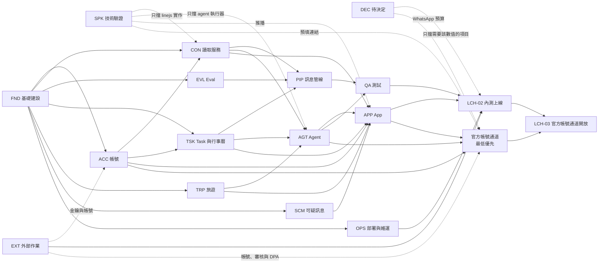

# 工作項目清單

- 日期：2026-11-13
- 更新：2026-11-14，官方帳號通道列為最低優先，內測分兩階段上線
- 範圍：MVP（100 人以下內測）的全部工作。內測先以 App 上線（LCH-02），官方帳號通道之後再開放（LCH-03）
- 依據：[ADR 索引](../adr/README.md)、[系統設計文件](../design/system-design.md)、[OpenAPI spec](../api/openapi.yaml)

本文件把 ADR 與設計文件拆成可以逐項執行的工作項目，並標出相依關係。產品裡的「task」是用戶的待辦事項，為了避免混淆，這裡一律稱為**工作項目**。

## 怎麼讀這份清單

- **ID** 是穩定的識別碼，之後新增項目不會重新編號。前綴表示類別，見下表。
- **出處** 是該項目依據的 ADR 或設計文件章節。
- **相依** 列出必須先完成的項目。「—」表示沒有相依，可以立刻開始。**這一欄是相依關係的唯一依據**，圖只是概觀。
- **完成條件** 是判斷該項目做完的標準。
- **狀態**：`未開始`、`進行中`、`完成`；決策類項目用 `待決定`、`已決定`。
- 名稱前有 **`[OA]`** 的項目屬於官方帳號通道，優先順序最低，見[優先順序](#優先順序)。

本文件不含時程、工時與負責人。

### 類別

| 前綴 | 類別 | 說明 |
|---|---|---|
| `SPK` | 技術驗證 | 開工前要先確認的未知數，結果可能推翻 ADR |
| `EXT` | 外部作業 | 帳號申請、審核、法遵文件等有外部等待時間的工作 |
| `DEC` | 待決定 | ADR 與設計文件留下的未決事項，需要專案擁有者決定 |
| `FND` | 基礎建設 | monorepo、資料庫、佇列、服務骨架 |
| `ACC` | 帳號 | 登入、同意、設定、推播、通知中心、帳號刪除 |
| `CON` | 讀取服務 | connector、LINE 連結、讀取範圍 |
| `EVL` | Eval | 管線品質的評估資料與執行器 |
| `PIP` | 訊息管線 | 視窗、LLM 呼叫、task 分流、詐騙警告 |
| `TSK` | Task 與行事曆 | task、待確認清單、提醒、行事曆、保存期清除 |
| `SCM` | 可疑訊息 | 警告的 API |
| `TRP` | 旅遊 | Trip 與行程項目 |
| `AGT` | Agent | 工具、執行器、對話 API、記憶 |
| `OAC` | 官方帳號通道 | 綁定、LINE 與 WhatsApp 的 webhook 與回覆。整類都是最低優先 |
| `APP` | App | Expo App 的各個畫面 |
| `OPS` | 部署與維運 | 基礎設施、部署、備份、監控 |
| `QA` | 測試 | 跨項目的測試基礎與安全測試 |
| `LCH` | 上線 | 設定值定案、內測上線檢查、官方帳號通道開放檢查 |

## 優先順序

主要功能由 App 互動。官方帳號（LINE、WhatsApp）上的 agent 對話是 MVP 內優先順序最低的工作。這是專案擁有者在 2026-11-14 的決定。

- **內測分兩階段上線。** 內測先以 App 上線（LCH-02）。官方帳號通道在那之後另外通過一道檢查才開放（LCH-03）。兩者都在 MVP 內，ADR-0011、ADR-0012、ADR-0024 的決定不變。
- **官方帳號通道的項目**：OAC-01 到 OAC-07、APP-13、APP-16、QA-05、SPK-05、EXT-03、EXT-04、EXT-11、DEC-05、LCH-03。名稱前都標了 `[OA]`。
- **App 主線不相依於官方帳號通道。** 上面這些項目以外的工作項目，都不相依於其中任何一項，所以這一批可以整批延後而不影響內測上線。新增或修改項目時要維持這一點。
- **優先順序寫在這一節，不寫進相依欄。** 相依欄只記錄技術上必須先完成的項目。官方帳號通道的項目沒有為了排序而加上對 App 項目的相依。
- **EXT-04 暫時不送件。** 專案擁有者在 2026-11-14 決定：系統與用戶的主要溝通方式是 App push，WhatsApp 官方帳號是低優先，所以 Meta 的商業帳號驗證與號碼審核暫時不需要送。接受的後果是這項審核的等待時間不由我方控制，之後要開放官方帳號通道時，LCH-03 的時程會由 EXT-04 決定。

## 相依概觀

這張圖只到類別層級，用來看大方向。實際的相依以各表的「相依」欄為準。「官方帳號通道」這個節點代表上一節列出的所有 `[OA]` 項目，不只 `OAC` 類別。

### 拆相依的三條原則

兩個關鍵函式庫（linejs、OpenAI Agents SDK 的 adapter）都還沒驗證。為了不讓它們卡住整張圖，相依是這樣切的：

1. **linejs 的驗證只擋 linejs 的實作（CON-04）。** 其餘所有工作都依賴 connector 介面與假的 connector 實作（CON-01），不需要真的 LINE 帳號。
2. **adapter 的驗證只擋 agent 執行器（AGT-06）。** 工具的邏輯（task、行程、記憶、檢索、地圖）是一般的程式，只依賴資料層；驗證不過而改用 Anthropic SDK 的 Tool Runner 時，這些邏輯可以原樣沿用。
3. **決策項目只擋需要那個數值的項目。** 門檻與時間常數都是設定，功能可以先做，數值在上線前定案（LCH-01）。

### 可以立刻開始的項目

沒有任何相依的項目：SPK-01、SPK-03、SPK-04、SPK-05、SPK-06、EXT-01 到 EXT-11、DEC-01 到 DEC-04、DEC-07 到 DEC-09、FND-01、EVL-01、OPS-01。

技術驗證與外部作業建議最先啟動：前者可能推翻 ADR，後者有不受控的等待時間。其中 SPK-05、EXT-03、EXT-04、EXT-11 屬於官方帳號通道，不在建議最先啟動之列，見[優先順序](#優先順序)。

## SPK 技術驗證

| ID | 工作項目 | 出處 | 相依 | 完成條件 | 狀態 |
|---|---|---|---|---|---|
| SPK-01 | linejs 能力驗證 | ADR-0001、ADR-0003、ADR-0021 | — | 用真實帳號確認並寫成紀錄：QR 與驗證碼的實際順序；端對端加密訊息在一對一與群組的解密範圍；模擬的裝置類型是否擠掉用戶的電腦版 LINE；能否區分一般帳號、群組、官方帳號；服務停擺後能否補收停擺期間的訊息。任何一項不符預期時，提出對 ADR-0001 或 ADR-0003 的修訂。另外確認安裝來源：ADR-0001 寫的 `@evex/linejs` 在 npm 上不存在，npm 上有的是 `@evex-dev/linejs`（2026-11-14 查閱） | 未開始 |
| SPK-02 | linejs 多連線穩定性 | ADR-0001、ADR-0019 | SPK-01 | 在單一 Node 程序內同時維持多個連線，記錄每個連線的記憶體用量、重連行為、分批重連的可行間隔；據此估計 100 個連線的資源需求 | 未開始 |
| SPK-03 | OpenAI Agents SDK adapter 搭配 Claude Opus 5.5 | ADR-0013 | — | 逐項確認 ADR-0013 列的 8 個驗證項目：工具呼叫與平行工具呼叫、串流、自訂 session 儲存、thinking 區塊原樣回傳、不送出強制的 `tool_choice`、prompt caching 控制、tracing 完全關閉、對話摘要的可行做法。第 1 到 5 項有任何一項無法解決就重開 ADR-0013 | 未開始 |
| SPK-04 | Expo 取得 iOS 的 FCM registration token | ADR-0018 | — | 在 development build 上，iOS 與 Android 都能取得 FCM registration token 並收到後端經 FCM 發出的推播；記錄選用的套件與設定 | 未開始 |
| SPK-05 | [OA] 官方帳號預填訊息連結 | ADR-0012、ADR-0024 | — | 確認 LINE 開啟官方帳號並預填訊息的 URL scheme，以及 `wa.me` 預填訊息連結，在 iOS 與 Android 上的行為；不可行時記錄改用手動輸入綁定碼 | 未開始 |
| SPK-06 | 中文關鍵字索引選型 | ADR-0015 | — | 用繁體中文的測試資料比較 `pg_bigm` 與 `pg_trgm` 對兩字詞查詢的結果與效能，並確認在 Docker 的 PostgreSQL 與 RDS 上都可用；選定其中一個 | 未開始 |

## EXT 外部作業

| ID | 工作項目 | 出處 | 相依 | 完成條件 | 狀態 |
|---|---|---|---|---|---|
| EXT-01 | Google Cloud 專案、OAuth client 與 Maps 金鑰 | ADR-0017、ADR-0023 | — | 建立專案；取得 iOS、Android 與後端驗證用的 OAuth client ID；啟用 Places API 與 Routes API，金鑰限制來源並設定每日配額上限 | 未開始 |
| EXT-02 | Firebase 專案與 APNs 金鑰 | ADR-0018 | — | 建立 Firebase 專案；上傳 APNs 金鑰；取得後端呼叫 FCM HTTP v1 用的服務帳號 | 未開始 |
| EXT-03 | [OA] LINE 官方帳號與 Messaging API channel | ADR-0011 | — | 建立官方帳號與 Messaging API channel；取得 channel secret 與 access token；可以設定 webhook 網址 | 未開始 |
| EXT-04 | [OA] Meta 商業帳號、WhatsApp 號碼與費率 | ADR-0024 | — | 完成 Meta 商業帳號驗證、專用電話號碼與顯示名稱審核；取得 Cloud API 的 token 與 app secret；查到台灣區（Rest of Asia Pacific）service message 的實際費率 | 未開始 |
| EXT-05 | Anthropic API 帳號與金鑰 | ADR-0006 | — | 取得 Claude API 金鑰，可以呼叫 Claude Haiku 5.5 與 Claude Opus 5.5 | 未開始 |
| EXT-06 | 同意文件 | ADR-0002、ADR-0022 | — | 完成三份文件的第一版並有可公開存取的網址：服務條款與隱私政策、LINE 非官方連線風險告知、LLM 處理與跨境傳輸。隱私政策載明 ADR-0022 列出的處理者、儲存地、保存期限與備份保存天數 | 未開始 |
| EXT-07 | DPIA 與合法利益評估 | ADR-0022 | — | 完成書面的 DPIA，涵蓋 ADR-0022 列出的五個高風險項目；評估要求額外緩解時，以新的 ADR 記錄 | 未開始 |
| EXT-08 | Apple 與 Google 的發佈帳號與登入規範 | ADR-0018、ADR-0023 | — | 取得 Apple Developer 與 Google Play 的發佈帳號；確認 App Store 審查規範對只提供 Google 登入的 App 的現行要求，以及 TestFlight 外部測試的審查要求 | 未開始 |
| EXT-09 | Google Maps Platform 的內容保存條款 | ADR-0017 | — | 對照現行條款，確認除了地點 ID 之外，名稱、地址、座標、營業時間可以保存多久；結論寫成紀錄 | 未開始 |
| EXT-10 | 各處理者的資料處理協議（DPA） | ADR-0022 | — | 確認與 Anthropic、AWS、Google 的資料處理協議，並記錄 Anthropic 的資料保留期限。這一項只擋內測上線，不擋開發。Meta 的部分在 EXT-11 | 未開始 |
| EXT-11 | [OA] Meta 的資料處理協議 | ADR-0022、ADR-0024 | — | 確認與 Meta 的資料處理協議。這一項只擋官方帳號通道開放，不擋內測上線 | 未開始 |

## DEC 待決定

這些項目需要專案擁有者決定，不是實作工作。決定後更新對應的 ADR 或設計文件。

| ID | 工作項目 | 出處 | 相依 | 完成條件 | 狀態 |
|---|---|---|---|---|---|
| DEC-01 | agent 對話紀錄的保存期限 | ADR-0014 | — | 決定保存天數與是否讓用戶設定，更新 ADR-0014 的待決事項 | 待決定 |
| DEC-02 | 旅遊行程項目的提醒規則 | ADR-0016 | — | 決定是否只提醒 Trip 的開始，或加入逐項提醒，更新 ADR-0016 的待決事項 | 待決定 |
| DEC-03 | 取消 task 的信心門檻 | ADR-0008 | — | 決定「取消」是否使用比新增與修改更高的門檻 | 待決定 |
| DEC-04 | 記憶條目的數量上限 | ADR-0014 | — | 決定上限的數值 | 待決定 |
| DEC-05 | [OA] WhatsApp 的預算與上限 | ADR-0024 | EXT-04 | 依實際費率決定：每月全域預算（以則數或金額表示）、每位用戶的每日回覆上限、長結果的長度門檻 | 待決定 |
| DEC-06 | 詐騙通知的信心分級 | ADR-0009 | PIP-02 | 依管線 prompt 在 eval 上的結果決定高、中、低的切點 | 待決定 |
| DEC-07 | 帳號刪除完成的通知管道 | ADR-0022、設計文件第 14 節 | — | 決定用什麼管道通知；若用 email，確認新增的寄信服務並更新 ADR-0022 的處理者清單 | 待決定 |
| DEC-08 | 確認設計文件第 13 節的新預設 | 設計文件第 13 節 | — | 逐項確認或修改第 13 節列出的預設；修改的部分同步更新設計文件與 OpenAPI spec | 待決定 |
| DEC-09 | 資料庫角色隔離 | ADR-0005 | — | 決定是否讓兩個服務使用不同的資料庫角色，並把憑證欄位只授權給讀取服務 | 待決定 |
| DEC-10 | 是否加入 Sign in with Apple | ADR-0023 | EXT-08 | 依 Apple 的現行規範決定；需要加入時開新的 ADR 記錄帳號合併規則，並新增對應的工作項目 | 待決定 |

## FND 基礎建設

| ID | 工作項目 | 出處 | 相依 | 完成條件 | 狀態 |
|---|---|---|---|---|---|
| FND-01 | Monorepo 骨架 | ADR-0019 | — | 建立 `apps/mobile`、`services/connector`、`services/core`、`packages/shared` 的 workspace；選定套件管理工具、測試框架、lint 與格式化工具並設定 pre-commit；Node.js 24；**把實際的建置、lint、測試、跑單一測試的指令寫進 `CLAUDE.md`** | 完成 |
| FND-02 | 本機 Docker Compose | ADR-0020、ADR-0021 | FND-01 | 一個指令啟動 PostgreSQL 與兩個服務的容器；啟動方式寫進 `CLAUDE.md` 與 README | 完成 |
| FND-03 | CI | ADR-0019 | FND-01 | GitHub Actions 在每個 PR 上執行 lint、型別檢查、測試、建置，以及 OpenAPI spec 的 lint | 完成 |
| FND-04 | 資料庫 schema 與 migration | ADR-0020、設計文件第 4 節 | FND-02 | 選定 migration 工具；建立設計文件第 4.2 節的全部資料表、唯一約束與外鍵（來源訊息的外鍵為刪除時置空）；migration 可以從空資料庫重跑 | 未開始 |
| FND-05 | 資料存取層與用戶範圍 | ADR-0020 | FND-04 | 所有業務資料的查詢都經過統一的封裝並強制帶用戶範圍；有測試證明無法讀寫其他用戶的資料 | 未開始 |
| FND-06 | Job queue | ADR-0020 | FND-04 | 整合 pg-boss：延遲工作、定時工作、重試、失敗佇列；可以在資料庫交易內排入工作 | 未開始 |
| FND-07 | 設定與 secrets | ADR-0021、設計文件第 9.2 節 | FND-01 | 設計文件第 9.2 節的所有門檻與時間常數都由設定提供，程式裡沒有寫死的數值；secrets 從環境載入，不進 repository | 完成 |
| FND-08 | 核心服務骨架 | ADR-0019、設計文件第 6.1 節 | FND-01、FND-07 | 選定 HTTP 框架；實作 `application/problem+json` 錯誤格式、游標分頁、bearer 驗證的掛點、限流；結構化日誌，且不記錄訊息內文、agent 對話內容、LLM 的輸入輸出；API 與 worker 兩種啟動模式 | 未開始 |
| FND-09 | 由 OpenAPI spec 產生共用型別 | 設計文件第 6 節 | FND-01 | 從 `docs/api/openapi.yaml` 產生型別，供核心服務與 App 共用；spec 變更後型別不同步時 CI 會失敗。骨架採用 TypeScript 6.0，而 openapi-typescript 7.13 的 peer 範圍是 `^5.x`（2026-11-14 查閱），做這一項時要先確認相容性或改用別的產生工具 | 未開始 |
| FND-10 | Claude API client | ADR-0006 | FND-07、EXT-05 | 封裝對 Claude Haiku 5.5 的 structured outputs 呼叫、重試與錯誤分類；記錄每次呼叫的 token 用量但不記錄內容。把設定中的 `ANTHROPIC_API_KEY` 改成必填 | 未開始 |

## ACC 帳號

| ID | 工作項目 | 出處 | 相依 | 完成條件 | 狀態 |
|---|---|---|---|---|---|
| ACC-01 | Google 登入與 token | ADR-0023 | FND-05、FND-08、EXT-01 | 實作 tag `Auth` 的端點：驗證 Google ID token、邀請名單、以 `sub` 找到或建立帳號、簽發 access token 與 refresh token、輪替與重用偵測、登出。`not_invited` 與各種 token 錯誤都有測試。把設定中的 `GOOGLE_OAUTH_CLIENT_IDS` 與 `AUTH_TOKEN_SIGNING_KEY` 改成必填，並把 token 的有效期加進設定 | 未開始 |
| ACC-02 | 同意文件與同意紀錄 | ADR-0002、ADR-0022 | ACC-01 | 實作 tag `Consent` 的端點；首次登入未附同意時不建立帳號並回 `consent_required`；文件改版後受影響的功能回 `consent_required` | 未開始 |
| ACC-03 | 帳號與設定 | ADR-0004、ADR-0010 | ACC-01 | 實作 tag `Account` 中的 `/me` 與 `/me/settings`：保存期、時區、勿擾時段、各類通知開關。保存期的選項在設定裡可以調整（`MESSAGE_RETENTION_OPTIONS_DAYS`），OpenAPI spec 的 `RetentionDays` 卻把 `[7, 30, 90]` 寫死成 enum，兩者不一致，做這一項時決定以哪一邊為準；預設保存期也要加進設定 | 未開始 |
| ACC-04 | 裝置與推播 token | ADR-0018 | ACC-01 | 實作推播 token 的註冊與刪除；一個用戶可以有多台裝置；登出時刪除該裝置的 token | 未開始 |
| ACC-05 | 推播發送與通知中心 | ADR-0018 | ACC-04、FND-06、EXT-02 | 推播發送 worker：呼叫 FCM HTTP v1、重試、清除失效的 token、尊重各類通知開關；payload 只有概述；每則推播同時寫入通知中心；實作 tag `Notifications` 的端點。把設定中的 `FIREBASE_SERVICE_ACCOUNT_JSON` 改成必填 | 未開始 |
| ACC-06 | 帳號刪除 | ADR-0022 | ACC-01、CON-05、FND-06 | 帳號刪除的背景工作：以新的 Google ID token 再次確認、立即撤銷所有 token、中斷 LINE 連結、刪除該用戶的所有資料與官方帳號綁定；有測試確認刪除後沒有殘留資料 | 未開始 |
| ACC-07 | 帳號刪除完成的通知 | ADR-0022 | ACC-06、DEC-07 | 依 DEC-07 決定的管道，在刪除完成後通知用戶 | 未開始 |

## CON 讀取服務

| ID | 工作項目 | 出處 | 相依 | 完成條件 | 狀態 |
|---|---|---|---|---|---|
| CON-01 | Connector 介面與假實作 | ADR-0001、ADR-0019、設計文件第 3.2 節 | FND-01 | 定義平台無關的 connector 介面，**其中沒有任何發訊、已讀、加好友、改設定的方法**；提供可以用程式注入訊息與連線狀態的假實作，供其他項目測試 | 未開始 |
| CON-02 | 讀取服務骨架 | ADR-0019 | CON-01、FND-05 | 常駐程序；只在內部網路開放的控制介面；連線狀態寫回資料庫；啟動時還原 session 並分批、帶隨機延遲重連；不呼叫 LLM、不發推播、不對外開放 | 未開始 |
| CON-03 | 訊息入庫與讀取範圍 | ADR-0003、ADR-0007 | CON-02、FND-06 | 建立對話資料列；依讀取範圍過濾（一般帳號與群組預設讀取、其他官方帳號預設不讀、本產品的官方帳號略過）；範圍外的訊息不入庫；範圍內的訊息與視窗工作在同一個交易內寫入；重複的訊息不會重複入庫；非文字訊息只記錄類型 | 未開始 |
| CON-04 | linejs 實作 | ADR-0001、ADR-0005 | CON-01、SPK-01、FND-05 | 以 linejs 實作 connector 介面：QR 連結、自訂 storage 把 session 存進 PostgreSQL、訊息事件、對話類型判斷、登出連結裝置；只讀新進訊息 | 未開始 |
| CON-05 | LINE 連結與中斷 | ADR-0001、ADR-0002、ADR-0022 | CON-02、ACC-02 | 實作 tag `LINE Connection` 的端點：連結流程的建立、輪詢、取消；建立前檢查風險告知的同意版本；中斷連結時停止連線、登出裝置、刪除憑證，並依參數刪除已保存的訊息；定時清理過期的連結流程 | 未開始 |
| CON-06 | 連線失效通知 | ADR-0001 | CON-02、ACC-05 | session 失效時標記狀態，並發 App push 與通知中心通知，請用戶重新連結 | 未開始 |
| CON-07 | 對話清單與讀取設定 | ADR-0003、ADR-0015 | CON-03、ACC-01 | 實作 tag `Conversations` 的端點；用戶改成不讀取時刪除該對話已保存的訊息；變更後通知讀取服務更新範圍 | 未開始 |

## EVL Eval

| ID | 工作項目 | 出處 | 相依 | 完成條件 | 狀態 |
|---|---|---|---|---|---|
| EVL-01 | Eval 資料集 | ADR-0006、ADR-0009、設計文件第 10.2 節 | — | 一組標註過的繁體中文對話片段，以合成與去識別化的資料為主，涵蓋：ADR-0009 列出的各類詐騙手法、正常對話、含 task 的對話、改期與取消、容易誤判的案例 | 未開始 |
| EVL-02 | Eval 執行器 | ADR-0006、設計文件第 10.2 節 | EVL-01、FND-10 | 一個指令對指定的 prompt 與模型跑完整組 eval 並輸出：詐騙判定的精確率與召回率、task 抽取的正確率與重複率、日期時間的正確率、信心分數的校準；指令寫進 `CLAUDE.md`。基準結果由 PIP-02 產生，因為要先有管線 prompt | 未開始 |

## PIP 訊息管線

| ID | 工作項目 | 出處 | 相依 | 完成條件 | 狀態 |
|---|---|---|---|---|---|
| PIP-01 | 對話視窗機制 | ADR-0007 | CON-03 | 每個對話同時只有一個未處理的視窗；三個觸發條件（安靜時間、訊息上限、最長等待）先到先觸發，數值來自設定 | 未開始 |
| PIP-02 | 管線 prompt 與輸出 schema | ADR-0006、ADR-0007、ADR-0009 | FND-10、EVL-02 | 一次呼叫同時輸出詐騙判定與 task 操作，以 structured outputs 約束；詐騙手法分類放在可獨立更新的設定檔；呼叫不帶任何工具；用 EVL-02 跑出 Claude Haiku 5.5 的基準結果並記錄下來，品質不足時依 ADR-0006 評估改用 Claude Sonnet 5.5 | 未開始 |
| PIP-03 | 管線 worker | ADR-0007 | PIP-01、PIP-02 | 組合輸入（新訊息、前文、未完成 task、中繼資料）並呼叫模型；以視窗為鍵做到冪等；失敗重試，重試用盡進失敗佇列且不阻塞其他對話；丟棄指向不存在或不屬於該對話的 task 的操作 | 未開始 |
| PIP-04 | Task 分流 | ADR-0008 | PIP-03、TSK-01、TSK-03 | 依信心門檻把操作套用到行事曆或建立待確認項目；用戶修改過的 task 一律建立待確認項目；自動套用的變更留變更紀錄；同一個 task 的舊待確認項目標記為被取代；套用時產生提醒 | 未開始 |
| PIP-05 | 詐騙警告產生 | ADR-0009 | PIP-03、ACC-05 | 依信心分級建立警告：高信心發推播並寫入通知中心，中信心只建立警告；同一個對話短時間內只推播一次；分級的切點來自設定。切點在 DEC-06 決定前沒有值，沒有值時的行為在這一項決定，不可以在程式裡補數值；推播的間隔也要加進設定 | 未開始 |

## TSK Task 與行事曆

| ID | 工作項目 | 出處 | 相依 | 完成條件 | 狀態 |
|---|---|---|---|---|---|
| TSK-01 | Task | ADR-0004、ADR-0008 | FND-05、FND-08、ACC-01 | 實作 tag `Tasks` 的 task 端點：建立、查詢、修改、刪除、變更紀錄、還原、來源訊息；手動修改後標記為用戶修改過；task 不保存訊息原文；來源訊息過期時回 `source_expired` | 未開始 |
| TSK-02 | 待確認清單 | ADR-0008 | TSK-01、TSK-03、TSK-04 | 實作 tag `Task Proposals` 的端點：列出、接受（可附修改）、拒絕、來源訊息；接受時才產生提醒 | 未開始 |
| TSK-03 | 提醒 | ADR-0010 | TSK-01、FND-06、ACC-05 | 護欄（不早於現在、不晚於到期、數量上限、勿擾時段與 ADR-0010 的例外）；排程與發送；發送前重新檢查 task 狀態；task 時間變更時重新產生或平移；提醒的端點；勿擾時段的邊界情況有測試 | 未開始 |
| TSK-04 | AI 產生提醒時間 | ADR-0010 | TSK-03、FND-10 | 用戶或 agent 建立 task 且選擇由 AI 決定時，依任務類型產生提醒時間並套用護欄 | 未開始 |
| TSK-05 | 行事曆查詢 | ADR-0008、ADR-0016 | TSK-01、TRP-01 | 實作 tag `Calendar` 的端點：回傳日期範圍內的 task、與範圍重疊的 Trip、範圍內的行程項目 | 未開始 |
| TSK-06 | 保存期清除 | ADR-0004 | CON-03、FND-06 | 每日的背景工作依各用戶的保存期硬刪除過期訊息；task、待確認項目、警告的來源參照自動置空；縮短保存期後下一次清除就生效 | 未開始 |

## SCM 可疑訊息

| ID | 工作項目 | 出處 | 相依 | 完成條件 | 狀態 |
|---|---|---|---|---|---|
| SCM-01 | 可疑訊息警告的 API | ADR-0009 | FND-05、FND-08、ACC-01 | 實作 tag `Scam Alerts` 的端點：列出、查詢、變更狀態、回報是否正確、來源訊息；警告不保存訊息原文 | 未開始 |

## TRP 旅遊

| ID | 工作項目 | 出處 | 相依 | 完成條件 | 狀態 |
|---|---|---|---|---|---|
| TRP-01 | Trip 與行程項目 | ADR-0016 | FND-05、FND-08、ACC-01 | 實作 tag `Trips` 的端點：Trip 的建立、查詢、修改、刪除；行程項目的新增、修改、移動、刪除、當日重排；變更紀錄與還原；時間以 Trip 的時區解讀 | 未開始 |
| TRP-02 | Trip 的提醒 | ADR-0016、ADR-0010 | TRP-01、TSK-03、DEC-02 | 依 DEC-02 的決定實作 Trip 與行程項目的提醒 | 未開始 |

## AGT Agent

| ID | 工作項目 | 出處 | 相依 | 完成條件 | 狀態 |
|---|---|---|---|---|---|
| AGT-01 | Task 工具邏輯 | ADR-0013、ADR-0008 | TSK-01、TSK-04 | 查詢、建立、修改、完成、取消 task 的工具邏輯；建立時由 AI 產生提醒；寫入視同用戶修改並留變更紀錄；不接受用戶識別碼 | 未開始 |
| AGT-02 | 行程工具邏輯 | ADR-0013、ADR-0016 | TRP-01 | 查詢與建立 Trip，新增、修改、移動、刪除行程項目，重排當日順序的工具邏輯；以項目為單位修改；留變更紀錄 | 未開始 |
| AGT-03 | 記憶 | ADR-0014 | FND-05、FND-08、ACC-01 | 記憶條目的資料與工具邏輯（新增、修改、刪除）；實作 tag `Agent` 中的記憶端點（查看、修改、刪除）；條目上限來自設定。上限在 DEC-04 決定前沒有值，沒有值時的行為在這一項決定，不可以在程式裡補數值 | 未開始 |
| AGT-04 | 歷史訊息檢索 | ADR-0015 | SPK-06、CON-03 | 建立 SPK-06 選定的索引；檢索工具邏輯：關鍵字、對話或聯絡人、時間範圍、筆數上限，結果附前後文；對話清單工具；範圍由伺服器限定；結果有長度上限 | 未開始 |
| AGT-05 | 地圖工具 | ADR-0017 | EXT-01、EXT-09、FND-07 | 地點搜尋、地點詳情、路線時間三個工具邏輯；金鑰只在後端；只要求需要的欄位；每個用戶的呼叫次數限流；同一輪對話內重複查詢使用暫存；保存的地點欄位符合 EXT-09 的結論。把設定中的 `GOOGLE_MAPS_API_KEY` 改成必填 | 未開始 |
| AGT-06 | Agent 執行器 | ADR-0013、ADR-0014 | SPK-03、EXT-05、AGT-01、AGT-02、AGT-03、AGT-04、AGT-05 | 以 OpenAI Agents SDK 經 adapter 執行 Claude Opus 5.5；system prompt；每次執行載入記憶與近期對話；session 存 PostgreSQL；把各工具邏輯包成 function tool，用戶範圍由執行環境注入；破壞性操作要求確認；**tracing 關閉，沒有資料送往 OpenAI** | 未開始 |
| AGT-07 | Agent 對話 API | ADR-0013 | AGT-06、FND-08 | 實作 tag `Agent` 中的對話端點：建立、列出、刪除、訊息列表、SSE 串流；用戶端斷線後繼續執行並保存結果；同一個對話同時只有一個進行中的回覆。官方帳號通道的對話在 App 內接續由 OAC-07 負責 | 未開始 |
| AGT-08 | 對話摘要與對話紀錄保存期 | ADR-0014 | AGT-06、DEC-01 | 對話過長時依 SPK-03 確認的做法摘要較舊的輪次；依 DEC-01 的決定清除過期的對話紀錄 | 未開始 |

## OAC 官方帳號通道

這一類全部是最低優先，在內測以 App 上線之後才需要完成，見[優先順序](#優先順序)。

| ID | 工作項目 | 出處 | 相依 | 完成條件 | 狀態 |
|---|---|---|---|---|---|
| OAC-01 | [OA] 綁定碼與綁定 | ADR-0012、ADR-0024 | ACC-05、SPK-05 | 實作 tag `OA Bindings` 的端點：產生一次性綁定碼（只存雜湊、10 分鐘、一次性）與預填訊息連結、列出與解除綁定；綁定成功時寫入通知中心；驗證失敗限流；定時清理過期的綁定碼 | 未開始 |
| OAC-02 | [OA] LINE webhook | ADR-0011、ADR-0012 | OAC-01、EXT-03、FND-08 | 實作 tag `Webhooks` 中的 LINE 端點：驗證 `X-Line-Signature`、立即回 200、以事件識別碼去重、處理綁定碼、未綁定的用戶回固定訊息且不觸發 agent | 未開始 |
| OAC-03 | [OA] LINE 官方帳號的回覆流程 | ADR-0011 | OAC-02、AGT-06、ACC-05 | 顯示 loading animation；期限內用 reply 回覆；逾時先用 reply 回「處理中」，結果寫進 App 對話並發 App push；**永不使用 LINE 的 push message**；提供這個通道的執行次數與逾時比例指標 | 未開始 |
| OAC-04 | [OA] WhatsApp webhook | ADR-0024 | OAC-01、EXT-04、FND-08 | 實作 tag `Webhooks` 中的 WhatsApp 端點：GET 驗證握手、驗證 `X-Hub-Signature-256`、立即回 200、去重、以 business-scoped user ID 處理綁定、不保存電話號碼、未綁定的用戶每個視窗只回一次。驗證握手用的 verify token 與發訊用的電話號碼 ID 還不在設定裡，在這一項加入 | 未開始 |
| OAC-05 | [OA] WhatsApp 官方帳號的回覆流程 | ADR-0024 | OAC-04、AGT-06 | typing indicator；短答案直接回；長結果把完整內容寫進 App 並只回一則摘要加 App 連結；只在 customer service window 內發送，不發 template 訊息；每則送出的訊息都寫入紀錄 | 未開始 |
| OAC-06 | [OA] WhatsApp 預算控管 | ADR-0024 | OAC-05、DEC-05 | 每月全域預算與每位用戶的每日上限；達到上限時每個視窗只回一次固定訊息，之後不回應；保留一部分預算給固定訊息；提供送出則數與預算使用率的指標，用量達門檻時告警；DEC-05 決定的數值回填到設計文件第 9.2 節 | 未開始 |
| OAC-07 | [OA] 在 App 接續官方帳號通道的對話 | ADR-0011、ADR-0014、ADR-0024 | AGT-07、OAC-03、OAC-05 | 官方帳號通道的對話出現在 App 的 agent 對話列表；從 App 接續時這一輪只在 App 內進行，回覆不送到 LINE 或 WhatsApp；用戶回到官方帳號時 agent 看得到 App 內的這幾輪；同一個對話不論從哪個通道發起，同時只有一個進行中的回覆 | 未開始 |

## APP App

| ID | 工作項目 | 出處 | 相依 | 完成條件 | 狀態 |
|---|---|---|---|---|---|
| APP-01 | Expo 專案骨架 | ADR-0018 | FND-01、FND-09 | Expo development build；導覽結構；使用 FND-09 產生的型別的 API client，含 token 自動換發；token 存在裝置的安全儲存區 | 未開始 |
| APP-02 | 登入與同意畫面 | ADR-0023、ADR-0022 | APP-01、ACC-01、ACC-02、EXT-01 | Google 登入；首次登入顯示文件並取得同意；處理 `not_invited` 與 `consent_required`；文件改版時引導重新同意 | 未開始 |
| APP-03 | 推播整合 | ADR-0018 | APP-01、SPK-04、ACC-04、EXT-02 | 取得並回報 FCM token；處理權限；點擊推播後導向對應畫面並向後端載入細節；權限關閉時提示用戶 | 未開始 |
| APP-04 | LINE 連結畫面 | ADR-0001、ADR-0002 | APP-02、CON-05 | 顯示風險告知並取得同意；依連結流程的狀態顯示 QR code 或驗證碼，不假設固定順序；顯示連線狀態；中斷連結 | 未開始 |
| APP-05 | 對話讀取範圍畫面 | ADR-0003 | APP-02、CON-07 | 列出對話；排除一般對話與群組；opt-in 其他官方帳號；說明排除會刪除已保存的訊息 | 未開始 |
| APP-06 | 行事曆 | ADR-0008、ADR-0016 | APP-02、TSK-05 | 日、週、月檢視；Trip 在月與週檢視顯示成跨日區塊；日檢視把行程項目與 task 依時間並排 | 未開始 |
| APP-07 | Task 詳情與編輯 | ADR-0008、ADR-0010 | APP-06、TSK-01、TSK-03、TSK-04 | 建立與編輯 task；管理提醒；查看變更紀錄並還原；查看來源訊息，過期時顯示「來源訊息已過期」 | 未開始 |
| APP-08 | 待確認清單畫面 | ADR-0008 | APP-02、TSK-02 | 列出待確認項目，區分新增、修改、取消；修改與取消顯示前後對照；接受（可先調整）與拒絕 | 未開始 |
| APP-09 | 可疑訊息警告畫面 | ADR-0009 | APP-02、SCM-01 | 列出警告並標示等級；查看理由與來源訊息；回報「這不是詐騙」；標記為已處理 | 未開始 |
| APP-10 | Trip 與行程畫面 | ADR-0016、ADR-0017 | APP-02、TRP-01 | 建立與編輯 Trip；逐日行程；新增、修改、拖移、刪除行程項目；時間衝突提示；以地點 ID 或座標開啟地圖導航；變更紀錄與還原 | 未開始 |
| APP-11 | Agent 對話畫面 | ADR-0013、ADR-0014 | APP-02、AGT-07 | SSE 串流顯示回覆與工具進度；多個對話；斷線後重新載入回覆。顯示與接續官方帳號通道的對話由 APP-16 負責 | 未開始 |
| APP-12 | 記憶管理畫面 | ADR-0014 | APP-02、AGT-03 | 查看、修改、刪除每一條記憶 | 未開始 |
| APP-13 | [OA] 官方帳號綁定畫面 | ADR-0012、ADR-0024 | APP-02、OAC-01 | LINE 與 WhatsApp 各自的綁定狀態；產生綁定碼並開啟預填訊息連結；解除綁定 | 未開始 |
| APP-14 | 通知中心與設定畫面 | ADR-0004、ADR-0010、ADR-0018、ADR-0022 | APP-02、ACC-03、ACC-05、ACC-06 | 通知中心；設定保存期、勿擾時段、各類通知開關；登出；刪除帳號（再次確認） | 未開始 |
| APP-15 | 內測發佈 | ADR-0018 | APP-03、EXT-08 | 以 EAS Build 產生版本；透過 TestFlight 與 Google Play internal testing 發給內測用戶 | 未開始 |
| APP-16 | [OA] 在 Agent 對話畫面顯示官方帳號通道的對話 | ADR-0011、ADR-0014、ADR-0024 | APP-11、OAC-07 | 對話列表標示來自 LINE 或 WhatsApp 的對話；可以查看完整內容並接著問；從官方帳號回覆裡的連結開啟 App 時，導向對應的對話或 Trip | 未開始 |

## OPS 部署與維運

| ID | 工作項目 | 出處 | 相依 | 完成條件 | 狀態 |
|---|---|---|---|---|---|
| OPS-01 | 基礎設施 | ADR-0021 | — | 用 Terraform 在 AWS 東京區域建立 EC2、安全群組（對外只開 443）、加密的 EBS、備份用的 S3 | 未開始 |
| OPS-02 | 線上 Docker Compose | ADR-0021 | OPS-01、FND-02 | 反向代理負責 TLS；`core-api`、`core-worker`、`connector`、PostgreSQL；讀取服務與資料庫不對外開放；secrets 以環境檔或 secret 服務注入，每個服務各自一份，讀取服務不可以拿到核心服務的金鑰（拿到會拒絕啟動） | 未開始 |
| OPS-03 | 部署流程 | ADR-0019、ADR-0021 | OPS-02、FND-03 | GitHub Actions 建置並推送映像；兩個服務可以分開部署，部署核心服務不重啟讀取服務；部署讀取服務時先停掉舊的容器再啟動新的，任何時間只有一個讀取服務在執行（ADR-0025）；部署步驟寫進 README | 未開始 |
| OPS-04 | 備份與還原 | ADR-0021 | OPS-02 | PostgreSQL 每日備份到 S3，加密、限制存取、設定保存天數；完成一次還原演練並記錄；保存天數回填到隱私政策 | 未開始 |
| OPS-05 | 指標與告警 | ADR-0002、設計文件第 10.1 節 | OPS-02、CON-02、PIP-03 | 設計文件第 10.1 節列出的指標；告警：異常登出數突增、管線佇列持續堆積、備份失敗。官方帳號通道的指標不在這一項：LINE 逾時比例由 OAC-03 負責，WhatsApp 的送出則數、預算使用率與告警由 OAC-06 負責 | 未開始 |
| OPS-06 | 資料庫存取控管 | ADR-0005 | OPS-02、DEC-09 | 資料庫只接受內部網路連線；備份的存取權限受限；依 DEC-09 的決定設定資料庫角色 | 未開始 |

## QA 測試

各工作項目自己的單元測試包含在該項目的完成條件內。這裡是跨項目的測試。

| ID | 工作項目 | 出處 | 相依 | 完成條件 | 狀態 |
|---|---|---|---|---|---|
| QA-01 | 整合測試基礎 | 設計文件第 11 節 | FND-05、FND-06、CON-01 | 測試可以啟動真實的 PostgreSQL 容器、使用假的 connector、重播錄製的模型回應；跑法寫進 `CLAUDE.md` | 未開始 |
| QA-02 | 契約測試 | 設計文件第 11 節 | FND-08、FND-09 | 每個已實作端點的請求與回應都對照 OpenAPI spec 驗證 | 未開始 |
| QA-03 | 訊息到提醒的端對端測試 | 設計文件第 11 節 | QA-01、PIP-04、PIP-05、TSK-03、TSK-06 | 用假的 connector 注入訊息，驗證：產生 task 與待確認項目、改期與取消、提醒、詐騙警告、管線冪等、保存期清除後來源參照置空 | 未開始 |
| QA-04 | 安全測試 | 設計文件第 7 節 | ACC-01、TSK-01、TRP-01、SCM-01、AGT-07、PIP-03 | 跨用戶存取一律 404；prompt injection 樣本不會讓管線產生 schema 以外的動作，也不會讓 agent 跨用戶或未經確認執行破壞性操作。官方帳號通道的部分在 QA-05 | 未開始 |
| QA-05 | [OA] 官方帳號通道的安全測試 | 設計文件第 7 節、ADR-0011、ADR-0024 | OAC-03、OAC-05、OAC-06 | webhook 簽章錯誤被拒絕；未綁定的用戶不會觸發 agent；帳號刪除後官方帳號綁定不殘留；經官方帳號送進來的 prompt injection 樣本不會讓 agent 跨用戶或未經確認執行破壞性操作；沒有任何程式路徑會發出 LINE 的 push message 或 WhatsApp 的 template 訊息 | 未開始 |

## LCH 上線

| ID | 工作項目 | 出處 | 相依 | 完成條件 | 狀態 |
|---|---|---|---|---|---|
| LCH-01 | 設定值定案 | 設計文件第 9.2 節 | DEC-03、DEC-04、DEC-06、PIP-05 | 設計文件第 9.2 節中標為未定的設定都有正式的值，並回填到設計文件。WhatsApp 的預算、每日上限與長結果門檻除外，由 OAC-06 回填、LCH-03 檢查 | 未開始 |
| LCH-02 | 內測上線檢查 | ADR-0022、設計文件第 14 節 | LCH-01、DEC-08、DEC-10、EXT-06、EXT-07、EXT-10、SPK-02、CON-04、CON-06、CON-07、ACC-07、TRP-02、AGT-08、APP-04、APP-05、APP-07、APP-08、APP-09、APP-10、APP-11、APP-12、APP-14、APP-15、OPS-03、OPS-04、OPS-05、OPS-06、QA-02、QA-03、QA-04 | 內測以 App 上線，不含官方帳號通道。DPIA 與 EXT-10 的 DPA 完成；同意文件已上線；邀請名單建立；官方帳號通道以外的技術驗證都有結論；官方帳號通道以外的 MVP 工作項目全部完成；用真實 LINE 帳號走完連結、訊息到 task、提醒、警告、App 內的 agent 對話 | 未開始 |
| LCH-03 | [OA] 官方帳號通道開放檢查 | ADR-0011、ADR-0012、ADR-0024 | LCH-02、OAC-06、OAC-07、APP-13、APP-16、QA-05、EXT-11 | 內測上線後，對內測用戶開放官方帳號通道。含 APP-13 與 APP-16 的 App 版本已發給內測用戶；WhatsApp 的預算、每日上限與長結果門檻有正式的值；隱私政策已載明 LINE 與 Meta 會處理官方帳號上的對話，若是內測上線後才補上，依同意文件改版的流程處理；用真實帳號走完 LINE 與 WhatsApp 的綁定、短答案、LINE 逾時改用 App push、WhatsApp 長結果導回 App、達到上限時的固定訊息 | 未開始 |

## 不在 MVP 範圍、正式上線前要做的事

這些項目不在上面的相依圖內。內測結束、對外開放之前再拆成工作項目。

| 項目 | 出處 |
|---|---|
| 讀取個人 WhatsApp 對話（whatsapp-web.js），含 session 保存方式的評估 | ADR-0001 |
| 資料匯出功能（內測期間由人工處理） | ADR-0022 |
| 部署轉到 ECS Fargate 與 RDS，用 Terragrunt 管理多環境 | ADR-0021 |
| 讀取服務的連線租約：容器登記與續約、認領、自我隔離、排空、持有權檢查、核心服務依持有者路由。要在讀取服務放上 ECS 之前完成 | ADR-0025 |
| 重新檢視儲存安全等級（訊息與 LINE 憑證的加密） | ADR-0005 |
| 重新檢視封號風險的處理方式是否適用於一般大眾 | ADR-0002 |
| 資料外洩的通報流程與應變計畫 | ADR-0022 |
| 法律顧問對隱私政策、同意流程、DPIA 的審閱 | ADR-0022 |
| 評估詐騙偵測加入外部訊號或較大模型複核 | ADR-0009 |
| 評估歷史訊息檢索加入向量檢索 | ADR-0015 |
| 評估 agent 加入網路搜尋工具 | ADR-0017 |

## 維護這份清單

- 完成一個項目後更新它的狀態。
- 新增項目時使用該類別的下一個編號，不重新編號既有項目。
- 技術驗證或決策的結果改變了設計時，先更新 ADR 或設計文件，再調整受影響的工作項目。
- 相依關係變更後，確認沒有形成循環，而且每個相依的 ID 都存在。
- 沒有標 `[OA]` 的項目不可以相依於標了 `[OA]` 的項目。新增官方帳號通道的項目時，名稱前加上 `[OA]`，並加進[優先順序](#優先順序)的清單。
